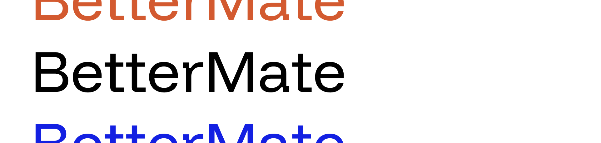
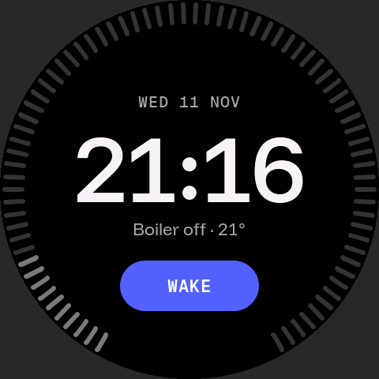
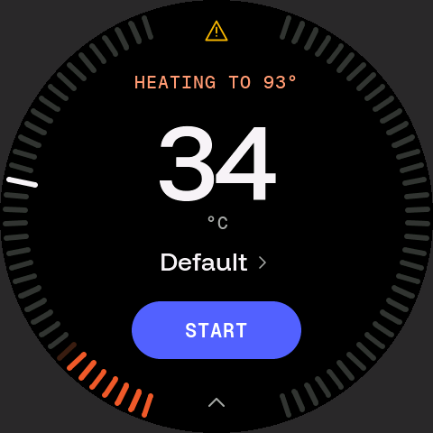
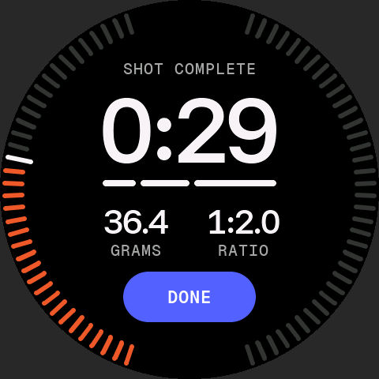
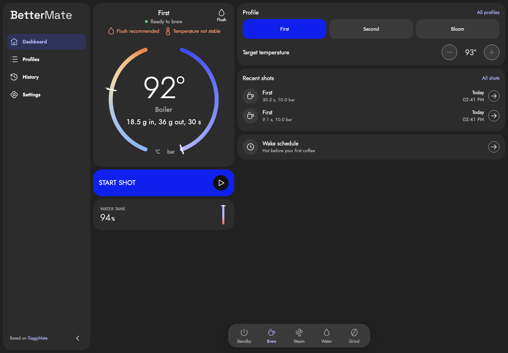
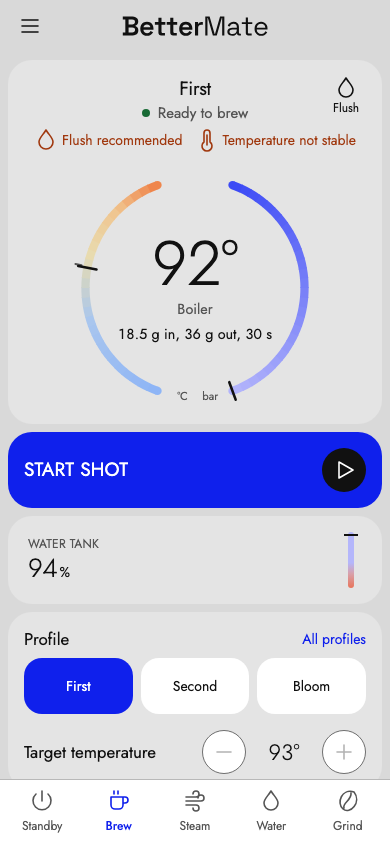

<p align="center">
  
</p>

# BetterMate

**Same machine, easier to use.**

BetterMate is a new display and web interface for [GaggiMate](https://github.com/jniebuhr/gaggimate). It runs on the
display you already have and pairs with the stock GaggiMate controller, which is never reflashed.

<p align="center">
  
  
  
</p>

## Only the screens change

GaggiMate's machine logic stays exactly as it is. BetterMate replaces the two things you look at and touch, and nothing
behind them.

**BetterMate replaces**

- The round display's interface: every screen, redrawn to be read from arm's length with a wet hand.
- The web app the machine serves: dashboard, profiles, shot history, settings and first-run setup.
- The name of the setup Wi-Fi network.

**GaggiMate keeps**

- The controller and its firmware, on stock `v1.9.0`. It is never reflashed.
- Heater, pump and valve control, and every safety limit.
- The link between display and controller, untouched, so the controller never reports a version mismatch.
- The REST and WebSocket API, the storage keys, the `gaggimate` network name, MQTT topics and the HomeKit name. Your
  integrations see the same machine.

## Five rules for the round display

1. One large reading and one primary action per screen.
2. Normal states stay hidden. Only exceptions appear.
3. Data sits on the rim: lit ticks for the value, a notch for the target.
4. A control that cannot be used is hidden, not greyed.
5. One unit style: a small label under every large reading.

## The web app

The app your machine serves over Wi-Fi draws the boiler the way the display does, puts the next thing you can do in one
banner, and keeps the modes in one bar you can reach with your thumb. It ships inside the display's flash, so it stays
small: two fonts in 41 KB, 53 icons in about 3 KB, and no images in the interface.

<p align="center">
  
  
</p>

## Where it stands

BetterMate is still in development.

| | |
| --- | --- |
| Round display | Every screen built and checked in the simulator, at 480 and 466 px. |
| Web app | Every page rebuilt and checked in Chromium. Not yet tried in Safari or on a phone. |
| On a real machine | Next: flashing it onto a display and measuring motion on the panel itself. |
| Release | No public release or browser installer yet. Panels: LilyGo T-RGB, Waveshare and CO5300 AMOLED. |

## Build

PlatformIO and Node 22 are required.

```shell
scripts/build_webui.sh                     # build the web app and pack it into the display firmware
pio run -e display                         # build the display firmware
pio run -e display -t upload -t monitor    # flash it and open the serial console
pio run -e display-sim -t run              # desktop simulator (needs `brew install sdl2`)
pio test -e native                         # unit tests
```

## License

BetterMate is forked from GaggiMate `v1.9.0`, which is the work of its authors. Like GaggiMate, it is licensed under
[CC BY-NC-SA 4.0](https://creativecommons.org/licenses/by-nc-sa/4.0/). Funnel Display and Geist Mono are under the SIL
Open Font License.
