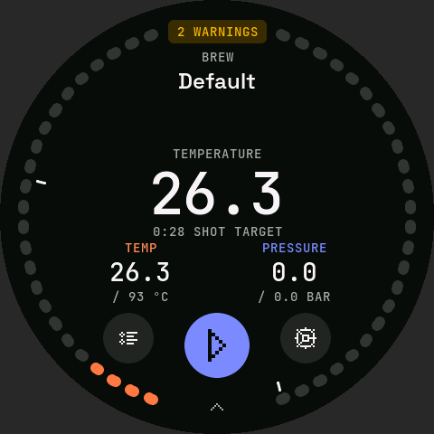
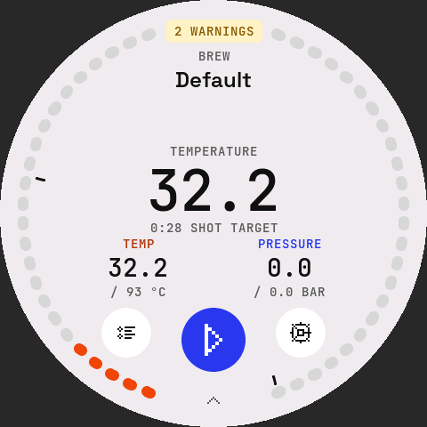
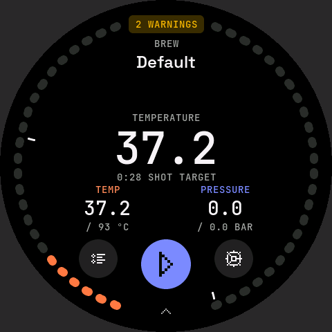
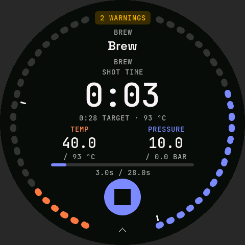
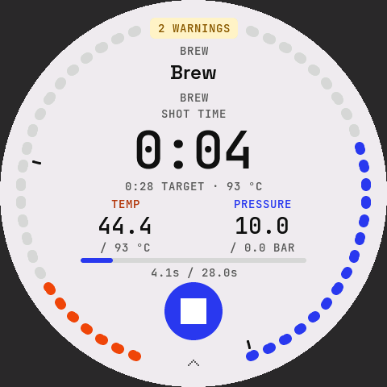
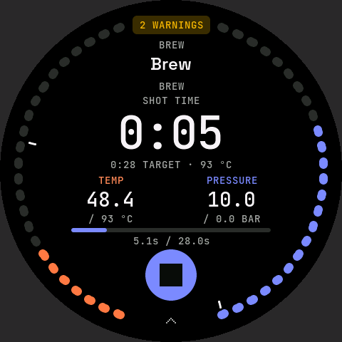

# Shared gauges and Brew/Status

BetterMate owns all nine real display screens. This directory records the shared gauges and Brew/Status port.
The shared draw widget keeps fixed 0–160 °C and 0–16 bar scales, both target markers, and a single
300° temperature ring when no pressure sensor is available. Split rings have 24 round-capped ticks;
the full ring has 52. Heating ticks alternate between heat and heat-soft at 1 Hz. Endpoints are cached
and only changed tick and marker bounds are invalidated.

| Screen | Dark | Light | AMOLED |
| --- | --- | --- | --- |
| Brew |  |  |  |
| Status |  |  |  |

Brew keeps profile selection, temperature and time/weight adjustments, save/accept/copy, weight-target
removal, tare, start and long-press flush. Tap the warning badge to read active warnings; an error-level
warning still requires the stock confirmation action. The modal blocks underlying taps and gestures.

Status shows the phase type/name, frozen elapsed time after a stop, live temperature/pressure pairs,
the shot target, phase progress, live/final weight, calibration and Finished. Stop and Done use the
stock deactivate/clear path. Both screens retain the menu arrow and swipe-up navigation; tapping
the hero opens the menu too. Opening the menu stops a running shot. The primary action sits above
the retained menu control so their touch areas remain separate.

## Verification

Run from the repository root:

```shell
pio run -e display-sim -e display
python3 scripts/verify_display_brew.py
python3 scripts/verify_display_standby.py
```

The Brew/Status suite passed **112 assertions** again on 2026-10-03 across eight isolated simulator cases: 105 input/state/text
assertions, two saved-profile checks, two rendered heating-pulse checks and three rendered stop-glyph
checks. The final adjustment-label spacing was checked again with the 21-assertion volumetric case.
The existing Standby suite also passed all 43 assertions; its logs are under `standby-regression/`.
Screenshots and logs alongside this file cover:

- Three themes, profile adjustments and dirty-only saving, persisted save/copy, profile/menu/Standby return.
- Single-ring fallback in all themes, timed fallback and restoration of the pressure ring.
- Scale readings, long-press tare, weight adjustments, target removal, volumetric phase progress, calibration,
  final weight, Done and manual stop.
- Timed progress, automatic completion and a second shot.
- Warning confirmation/cancellation, modal touch/gesture guards, disconnected start guards and error routing.
- Hold-to-flush release and fixed-duration flush; neither queues a shot after the finger lifts.
- The actual rendered heating tint and the stop glyph in all themes.

The simulator now separates Bluetooth cup weight from the controller's flow counter, including the scale's
prestart tare. This prevents controller-side tare after a stop from erasing the simulated final weight.
Its scale facade is registered on the simulator as well as hardware; hardware control behavior is unchanged.
New script verbs are `pressure-sensor 0|1`, `scale 0|1` and `weight <grams>`; `expect` can also check visible/hidden
labels and selected-profile temperature, duration and weight. Use `--case <name>` to run one verification case.

At the original Brew/Status milestone both simulator and LilyGo T-RGB firmware builds passed. That firmware used **3,624,329 bytes of flash (55.3%)**,
12,268 bytes above the Standby milestone, and **94,208 bytes of static RAM (28.7%)**. Generated version/timestamp
strings can change size slightly. No physical display was flashed or tested. Colors in captures have the panel's
RGB565 quantization. This work is uncommitted; the latest local milestone tag remains `v0.1.0-bettermate`.

## Next

All display ports and the web redesign are implemented. Review the later screen captures in `../modes/` and `../navigation/`, and the web captures in `../../webui/`. Current build measurements and remaining hardware validation are recorded in the workspace's `progress.md`. DefaultUI and EEZ cleanup are deferred at the user's request; the controller protocol remains unchanged.
