# Minimal luxury display

Implemented on `ui/minimal-luxury`, based on the committed checkpoint `713b80c8`.
The user's October 4 references guide Standby, mode selection, Brew and the profile wheel.
Every display page uses the same black, warm white and champagne direction as Standby and mode selection.
The October 6 usability continuation adds visible navigation, readable controls and explicit target/live readings; see [the implementation and verified previews](../../ui-usability/README.md).
The October 10 mode picker replaces the telemetry-heavy Modes page with a smooth vertical list; see [the behavior and previews](mode-picker/README.md).
The October 10 Brew continuation puts live temperature and pressure first and moves target changes into [Profiles](brew-profiles/README.md).

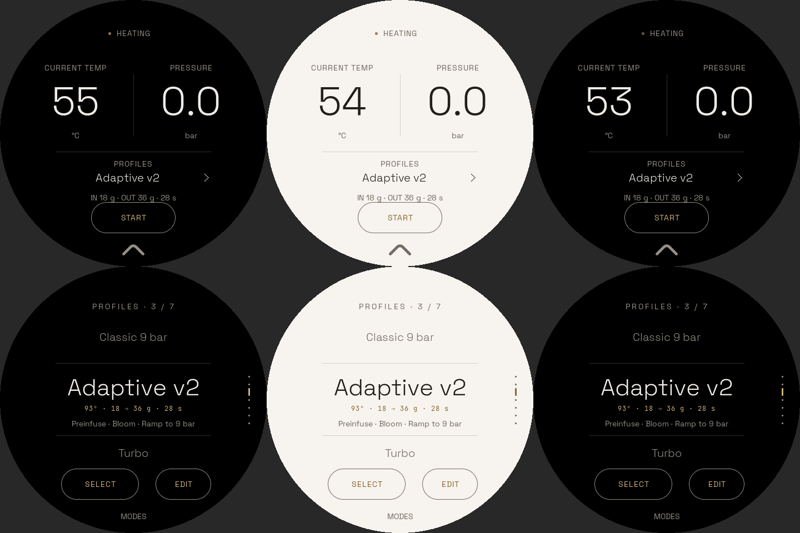


| Standby | Mode selection | Warnings |
| --- | --- | --- |
| 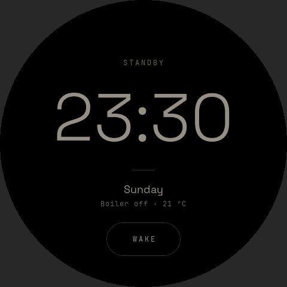 | 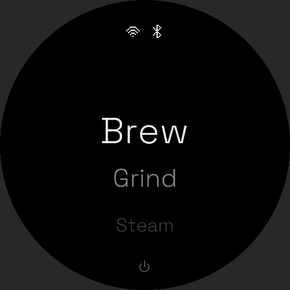 | 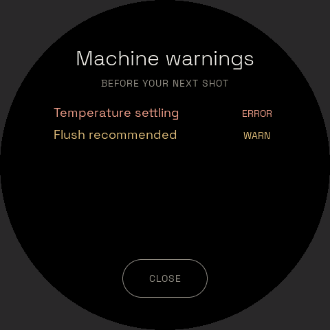 |

## Behavior

- Standby shows a large, light clock, weekday, boiler-off temperature and outlined Wake button.
  Tapping anywhere opens mode selection when the existing controller and system guards allow waking.
  Scheduled wake hints, 12/24-hour clocks, missing-clock fallback, system faults and AMOLED clock rest/drift are retained.
- Mode selection is a vertical picker in the order Brew / Grind / Steam / Water / Info.
  The focused mode is large; neighboring names smoothly shrink and fade with their distance from focus.
  Drag vertically to browse with momentum and a snap to the nearest item. The list stops at its first and last items.
  Tap any visible mode to open it; scrolling leaves the machine mode and process unchanged.
  Grind disappears when unavailable. Connectivity icons remain an Information shortcut;
  the small bottom power control returns to Standby. Recipe facts stay on Brew and Profiles.
- Mode selection uses a solid black background in Dark and AMOLED; Light retains the flat ivory theme.
  LVGL transparent layers support smooth label scaling.
- Swipe left on Modes to open every active warning, with a smooth horizontal slide,
  ordered with errors first and explicit WARN / ERROR labels. This view owns input;
  a right swipe or Close returns to the same scroll position. Brew retains the existing error-level confirmation.


- Brew shows current temperature and pressure as its large readings. Its passive status row shows only
  HEATING or READY, with a heating dot that animates independently of idle refresh.
  The Profiles row opens the profile picker, where Select applies a recipe and Edit opens its targets.
  Temperature, final Brew pressure, and weight/duration changes have Save, Session and Copy outcomes.
  Unsaved changes stay visible when returning to Profiles.
  A connected scale has a separate live-weight/Tare button. Start retains hold-to-flush.
  The original GaggiMate upward arrow and an upward swipe open mode selection; numbers have no tap action.
- The profile wheel shows one readable neighboring name above and below the focus. Each row is a 56 px
  touch target that browses to the name shown. Vertical/horizontal swipes remain shortcuts; long focus
  names scroll. Select applies the profile, and the upward arrow returns to Modes.
- Profiles may include optional `dose` metadata for dry coffee in grams. Existing profiles without it
  show a dash for IN; timed recipes show a dash for OUT. Dose survives save/copy and has no effect on
  controller or grinder behavior. Its optional field is documented in `schema/profile.json`.
- Water mirrors Brew's large passive current-temperature and pressure readings, separated by a fine vertical rule.
  A compact target-temperature row below the horizontal divider has its own minus/plus buttons. The status line
  identifies Water and its heating, cooling, ready or dispensing state. Start/Stop and the upward Modes arrow stay at the
  bottom. The Modes arrow has no caption, and warnings are available through the Modes warnings page instead of
  a strip on Water. Without a pressure sensor the temperature reading centers and the pressure column disappears.
- Steam retains its labeled target-temperature hero and direct minus/plus controls, with live temperature
  and pressure below it. Steam preserves automatic operation. Numeric readouts cannot exit or stop the process.
- Grind shows its target while idle and time remaining or ground weight while running. USE TIME / USE WEIGHT
  makes target selection explicit, and live-weight/Tare has a separate 56 px button. Target edits and tare
  are disabled during grinding; controller limits and automatic stopping are retained.
- The shot view uses a champagne pressure arc around a 0–16 bar dial, a large central elapsed timer,
  and a separate warm-white time arc at the bottom. The time arc tracks total elapsed time against the recipe duration,
  including weight-based and multi-phase shots; it freezes at the actual elapsed time when the shot ends.
  Profile and live pressure sit above the timer; the phase name sits below it.
  Live output and temperature show their targets in compact rows above Stop. The pressure dial disappears without a sensor.
  Warnings and the SHOT TIME heading stay hidden.
  Calibration stays visible after the pump stops; completion
  freezes the timer, shows FINAL OUT when available, and replaces Stop with Done.
- Warning indicators are removed from the working pages and Standby. Swipe left on Modes to view active
  conditions with WARN / ERROR labels. Brew retains its confirmation before starting with an error condition.
  Idle upward swipes open Modes. During a process, swipes leave it running; tapping the Modes arrow
  stops before exiting. The shot view hides Modes and blocks navigation until the shot completes;
  Stop returns to Brew, and completed shots offer Done and Modes.
- Brew, Steam, Water, Grind, Profiles, Information and completed shots share the same rounded upward arrow
  at the bottom, with a 56 px touch target. During Steam operation the arrow retains the
  STOP & MODES caption. Water and Grind keep the arrow alone. Active shots hide the arrow until completion.
- Information uses the same typography for the network, IP address and firmware versions. Its connection
  QR retains black modules, a white background and an eight-pixel quiet zone in every theme.
  Disconnected Wi-Fi shows an empty state and hides the stale address and QR.

| Brew Light | Profile Light | Adjustment | Scale |
| --- | --- | --- | --- |
| 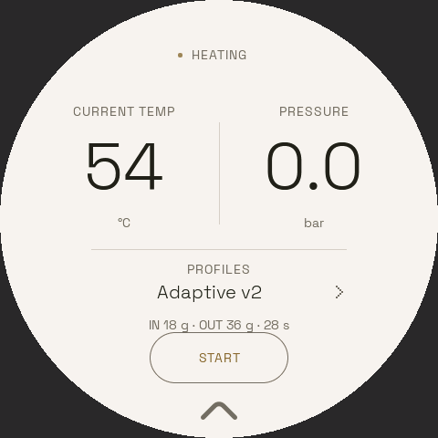 | 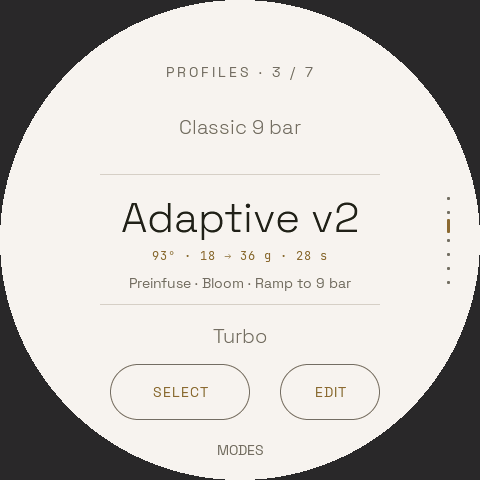 | 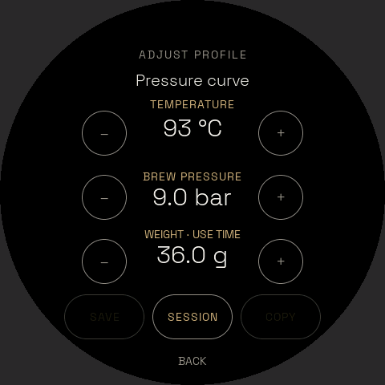 | 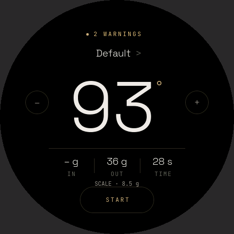 |

## Fonts and color

Black, warm off-white, quiet neutral labels and champagne accents are shared by every display screen.
Light mode uses warm ivory and bronze; AMOLED retains true black. The clock uses Jost 300
at 112 px and readings at 72 px. The mode picker uses a 60 px font, scaling its neighbors to approximately 42 and 31 px. Brew uses a 112 px reading,
a 42 px focused profile name and 20 px recipe values. Steam, Water, timed Grind and the shot timer use
112 px readings; weight targets use 72 px to fit the full supported range. Operational labels and controls use Jost 400 at 14 px; profile recipe details use Jost 400 at 12 px with the generated arrow.
Text and control outlines meet the source palette contrast targets; faint divider lines remain decorative.
Jost is bundled under OFL; the recipe arrow is an original generated outline. Tabular figures are resolved during display font generation so live readings retain their width. `LuxuryUI` supplies the scoped palette and controls.

Generated C assets build without Python or Node. To regenerate, use a Python environment with
fonttools, brotli and Pillow, plus lv_font_conv 1.5.3:

```sh
python scripts/design/gen_luxury_assets.py
```

Set `LV_FONT_CONV` to an installed converter command for offline generation.

## Verification

```sh
pio run -e display-sim -e display
python3 scripts/verify_display_luxury.py
python3 scripts/verify_display_standby.py
python3 scripts/verify_display_navigation.py
python3 scripts/verify_display_brew.py
python3 scripts/verify_display_modes.py
```

The Brew/Profile continuation passed 125 luxury checks (123 UI/clock assertions plus two saved-profile
checks), 112 Brew/Status checks and 76 navigation checks, including five decoded QR images.
The heating-dot case uses disabled warnings so warning status cannot mask its pulse. All eight Brew/Status
cases passed; the corrected heating case was rerun separately. Dark, Light and AMOLED captures are in `brew/`.

The earlier Standby/mode-selection milestone passed 406 assertions across all five suites, including
43 Standby checks and 76 Steam/Water/Grind checks. Their input paths were updated for the new Wake flow
and mode-row positions.

Both simulator and LilyGo T-RGB firmware builds passed after the remaining-page continuation. Firmware uses
about 3.78 MB of flash (57.6%) and 94.3 KB of static RAM (28.8%).
On October 4, 2026, the firmware was uploaded over USB to the connected ESP32-S3 circle display.
The uploader verified its firmware hash, and startup serial output showed no fatal boot errors.
Hardware verification was limited to flashing and startup with the espresso machine switched off.
A full 16 MB flash backup was saved first; the partition layouts match, and settings/profile storage was retained.

The remaining-page continuation passed 298 checks: 93 Steam/Water/Grind, 129 Brew/Status and 76 navigation,
including five decoded connection QR codes. The shot suite now follows Preinfuse → Bloom → Ramp,
checks that phase progress fills from the left, and compares completed timer captures to verify it freezes.
Warning details preserve an active Water process and block underlying adjustments and menu gestures.
The timed, phased, volumetric and Information cases were repeated after the final text and progress-line fixes.

Dark, Light and AMOLED captures of the remaining pages and their active, scale, calibration,
completion, warning and offline states are in `pages/`. The long development build version is
constrained to one line so it cannot overlap the controller version.

| Light pages | AMOLED pages |
| --- | --- |
| 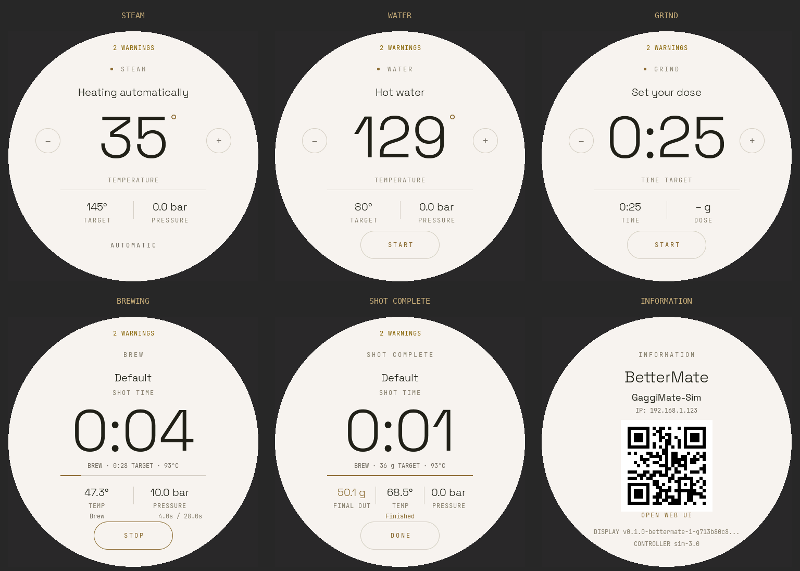 | 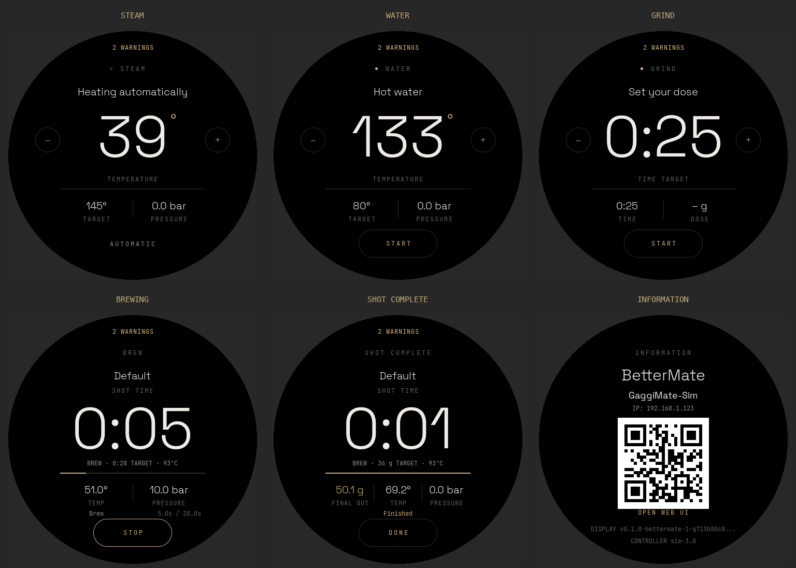 |

## Brewing dial

The October 18 shot view separates live pressure from total elapsed time, with a central timer and an explicit Stop action.

| Dark | Light | AMOLED |
| --- | --- | --- |
|  | 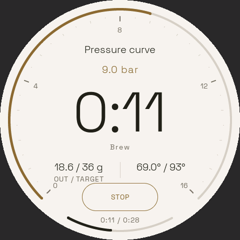 | 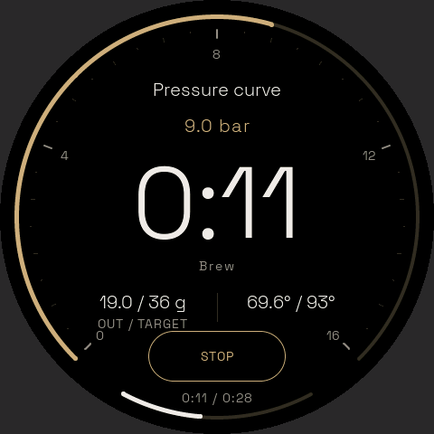 |
