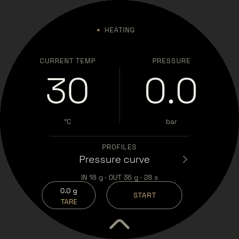
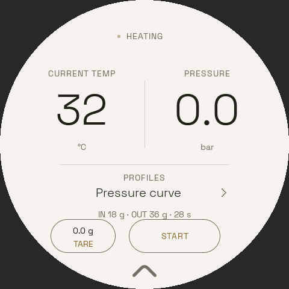
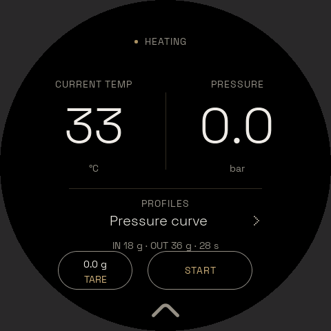
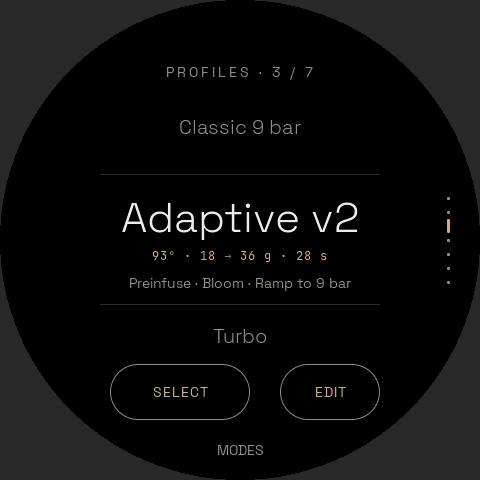
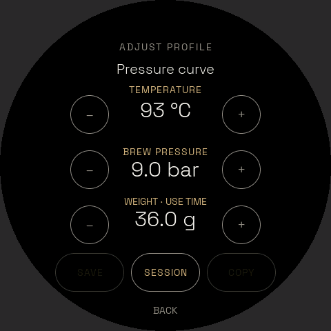
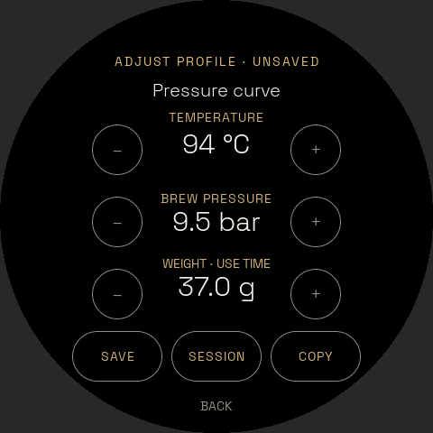

# Live Brew readings and profile targets

Implemented October 10, 2026. Brew opens with current temperature and pressure as the large readings.
The original GaggiMate upward arrow opens Modes. Tapping a reading has no action; the Profiles row opens
the profile picker. The black background is retained in Dark and AMOLED.

| Brew Dark | Brew Light | Brew AMOLED |
| --- | --- | --- |
|  |  |  |

Profiles has separate Select and Edit actions. Select applies the focused recipe and returns to Brew.
Edit opens that profile's temperature, Brew pressure, and weight/duration targets. Save updates the profile,
Session keeps changes active without saving, and Copy creates a new favorite. Back returns to the picker
with the edited recipe preview intact. Reopening the active profile preserves unsaved session changes.

| Profiles | Edit targets | Unsaved targets |
| --- | --- | --- |
|  |  |  |

Pressure changes affect the final pumping Brew phase. Other phases, transitions, flow limits and recipe
metadata are preserved. A power-based Brew phase offers Set Pressure, starting at 9 bar; its steppers
then adjust by 0.5 bar within 0.1–12 bar. Flow-controlled and hold profiles retain their existing control
mode. Machines without a pressure sensor hide that row and center the live temperature on Brew.

Readiness, warning confirmation, Start, hold-to-flush and scale/Tare behavior are retained.

## Verification

Both simulator and display firmware builds pass; all 255 targeted checks pass. Simulator checks cover live-reading taps, the original
arrow, profile browsing and selection, editing another profile directly, Save/Session/Copy persistence,
pressure limits, preinfusion and transition preservation, flow control, missing sensors, scale/Tare,
warning confirmation and navigation during active processes. Captures use the real LVGL renderer.

The updated desktop simulator is left open on Brew. The device firmware is built for review.
