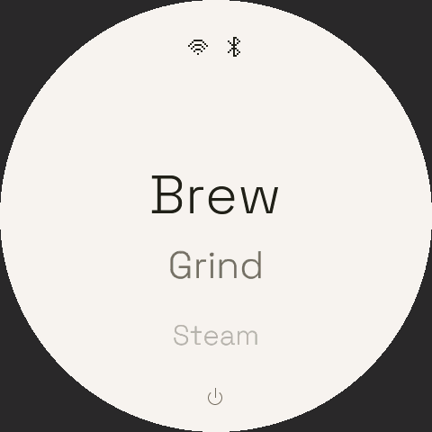
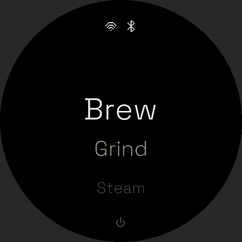
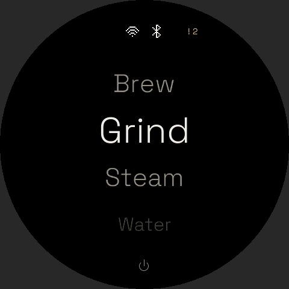
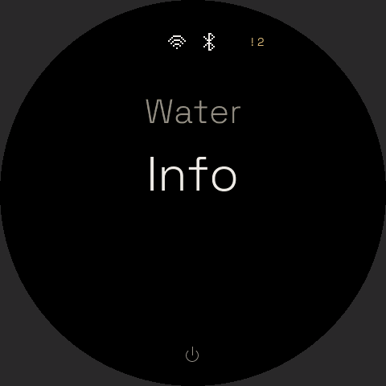
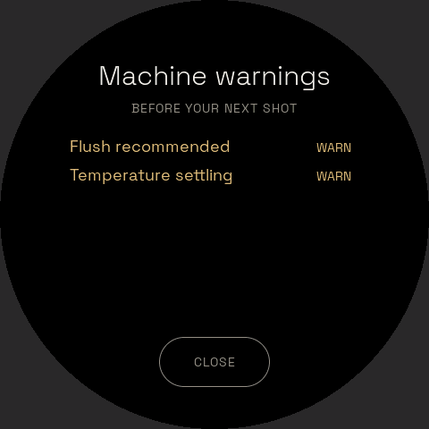

# Vertical mode picker

Implemented October 10, 2026 on `ui/minimal-luxury`, using the user’s [vertical mode reference](reference.png).

| Dark | Light | AMOLED |
| --- | --- | --- |
|  |  |  |

The page focuses on Brew, Grind, Steam, Water and Info. A native LVGL scroll surface follows the finger,
continues with momentum and snaps to the nearest mode. Labels scale and fade continuously while moving.
The list has finite ends; tap a visible name to open it. Browsing leaves the machine mode and process unchanged.
Grind is omitted when the configured machine does not support it.

Temperatures, pressure and recipe summaries remain on their working pages. Connectivity stays at the top,
with a small power control at the bottom. Swipe left anywhere on Modes to open the severity-labeled warnings page.
The pages follow the finger, coast and ease into place; short drags snap back. Swipe right or tap Close to return
to the same position in the mode list. The warnings page is also available when all is clear. It owns input,
and Brew retains its guarded confirmation.

The dedicated 60 px Space Grotesk 300 font contains only the mode names. Transparent LVGL layers enable
smooth zoom and opacity. The background is solid black in Dark and AMOLED, with flat ivory in Light.
The reference guides the layout; its gradient is omitted at the user’s request.

| Grind focus | Info focus | Warning details |
| --- | --- | --- |
|  |  |  |

## Verification

Simulator and LilyGo T-RGB firmware builds pass. All 263 assertions pass: 129 luxury checks excluding
the unchanged clock-rest case, 76 navigation/QR checks, and 58 usability checks. The five connection QR
captures decode correctly. After removing the gradient, both builds pass again, the 18 appearance assertions
pass, and pixel checks confirm solid black in Dark and AMOLED. Firmware uses 3,776,081 bytes of application flash.

Interaction checks cover all five destinations, forward
and reverse browsing, both ends of the list, hidden Grind, disconnected-controller guards, warning input
ownership, themes, profile editing, active-process controls and connection QR codes.

After changing LVGL renderer feature flags, clean both environments before rebuilding so cached library
objects use the same configuration as the screens:

```sh
pio run -e display -e display-sim -t clean
pio run -e display -e display-sim
SDL_VIDEODRIVER=dummy python3 scripts/verify_display_luxury.py --case navigation
SDL_VIDEODRIVER=dummy python3 scripts/verify_display_luxury.py --case single-sensor
SDL_VIDEODRIVER=dummy python3 scripts/verify_display_luxury.py --case warnings
SDL_VIDEODRIVER=dummy python3 scripts/verify_display_navigation.py
SDL_VIDEODRIVER=dummy python3 scripts/verify_display_usability.py
```

The preview runs in the desktop simulator. Device validation for this continuation is a successful firmware build.

October 20, 2026: removed the warning indicator and added horizontal paging to warnings. Both simulator and
LilyGo T-RGB firmware builds pass, along with 133 targeted assertions covering animation frames, short drags,
both swipe directions, Close, list boundaries, preserved mode focus, warning input ownership, interrupted
navigation, Brew confirmation, all three themes and the three-mode configuration. Firmware uses 3,780,325 bytes
of application flash. Run the warning cases with:

```sh
SDL_VIDEODRIVER=dummy python3 scripts/verify_display_luxury.py --case warnings
SDL_VIDEODRIVER=dummy python3 scripts/verify_display_luxury.py --case warnings-clear
```
