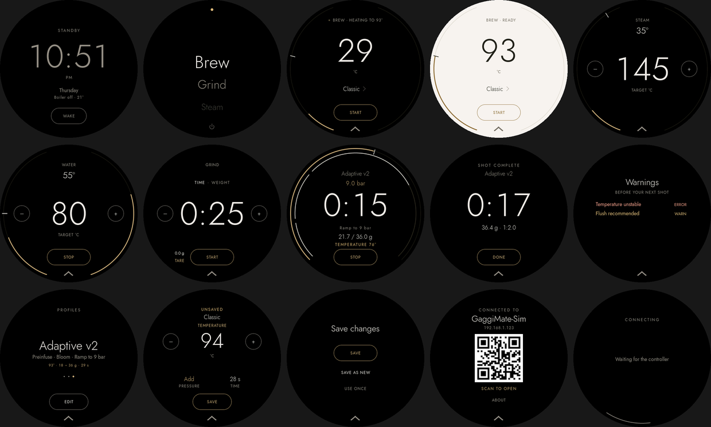
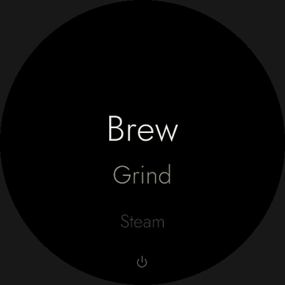

# Display rules

On October 20, 2026 every display screen was brought under five rules. The aim is a minimal, high-end face that
still shows everything the machine needs to say. The rules are written into `LuxuryUI.h`.
`scripts/verify_display_rules.py` checks them against the real LVGL screens in the simulator.

1. **One large reading and one primary action per screen.**
2. **Hide what is normal.** Connected, at temperature and without warnings means nothing is shown for them.
   Only exceptions appear: a warning dot, Wi-Fi loss, an available update, a stray shot temperature.
3. **The rim carries data.** Hairline arcs with a live value and a target notch replace gauges, numerals and
   progress text. Temperature is on the left and pressure on the right, using the stock fixed 0–160 °C and
   0–16 bar scales. Without a pressure sensor, temperature takes the whole dial. Pressure stays on the rim until a
   shot is brewing.
4. **Controls that cannot be used fade out** instead of greying. Steam, Water and Grind keep −/+ beside their
   target, as the stock screens do; they fade out only while a change cannot take effect, such as during a grind.
5. **One unit style.** A large reading carries a small unit label underneath. Small text uses "93°", "9.0 bar"
   and "36 g". Current and target values share their precision. There are no placeholder dashes.





## Screen by screen

| Screen | Large reading | Rim | Appears only when needed |
| --- | --- | --- | --- |
| Standby | clock | busy orbit while starting, connecting, updating or autotuning | warning dot, Wi-Fi loss, update; the next wake on the boiler line |
| Modes | focused mode | — | warning dot (opens warnings), Wi-Fi loss or update (open Information) |
| Brew | current temperature | temperature + target notch, pressure | "HEATING TO 93°", "UNSAVED", scale weight/Tare, warning dot |
| Steam, Water | target, between −/+ on the centre line; the live temperature under the mode name | temperature + target notch, pressure | "STOP & MODES" while steaming |
| Grind | target between −/+ on the centre line, then time remaining or weight | progress while grinding | TIME · WEIGHT above the target with a scale, Tare; −/+ hide while grinding |
| Shot | elapsed time | live pressure + phase target notch; one inner segment per phase | weight with a scale, "TEMPERATURE 88°" when it strays >3°, yield and ratio when done |
| Profiles | profile name | — | stage list for multi-phase recipes |
| Adjust | the focused value | — | the other values in a quiet row, "USE TIME" for weight targets, SAVE when changed |
| Information | connection QR | — | versions behind ABOUT |

Warnings no longer use a strip on any page. A dot at 12 o'clock opens the warnings page. Temperature does not
raise the dot, because the status line and the rim already show heating; Standby also ignores the flush reminder.
Brew keeps its confirmation before an error-level start. Adjusting a profile shows one value at a time. SAVE asks
once how to keep the change: save, save as new, or use once.

## Motion

One easing family (out when entering, in when leaving) and three durations: 120 ms for small fades, 240 ms for
state changes and 400 ms for page-level moves. A new screen's content fades in and rises 12 px part by part, while
the rim, its notches and the 12 o'clock indicators stay where they are; the whole panel never slides or
cross-fades. Readings glide to new values, rim arcs sweep, target notches slide, and the temperature arc briefly
brightens when it reaches its target. Only one thing breathes at a time, the heating dot, at about 0.55 Hz.
Animations touch small areas so the software-rendered ESP32-S3 panel can keep up. Frame rate on the physical panel
is still to be measured.

## Verification

```sh
pio run -e display-sim
SDL_VIDEODRIVER=dummy python3 scripts/verify_display_rules.py
```

The suite drives every screen and state in the simulator. At each checkpoint the new `layout` script verb writes
the visible object tree with real text extents, and the checker fails on any of the following:

- **overlap**: texts touching each other, or a control they do not belong to
- **edge**: text more than 220 px from the centre, or controls beyond 230 px
- **rim**: anything within 8 px of a rim arc it crosses
- **faded**: visible disabled or translucent controls
- **primary**: more than one outlined action, or steppers that do not set the screen's target
- **format**: inline "°C", placeholder dashes, "...", or mixed precision such as "38.2° / 93°"
- **rim** (also): gauge numerals near the rim, or pixel icons
- **motion**: transitions without intermediate frames
- **steady**: the rim dimming or moving while a new screen's content enters
- **text**: a status line that should carry a live value but does not match its pattern

`--check-only --output DIR` re-runs the checks on existing captures.

## Results (October 20, 2026)

- **Rules suite:** 68 checkpoints (65 layouts and 3 motion transitions) across all screens, three themes, both
  sensor configurations, scale, warnings and fault states, with 0 problems.
- **Older display suites:** updated to the new layout without dropping behavioral checks. Where a removed element
  had an equivalent, the check now uses that equivalent; the few pressure-number checks were inverted. Results:

  | Suite | Result |
  | --- | --- |
  | Standby | passed |
  | Luxury | 195 |
  | Navigation | 116, including 5 decoded QR codes |
  | Brew/Status | 275 |
  | Steam/Water/Grind | 130 |
  | Profiles | 105 |
  | Usability | 96 |

- **Native tests:** the 8 wake-schedule tests passed.
- **Firmware:** the simulator and LilyGo T-RGB builds passed. The firmware is 3,824,993 bytes of flash (58.4%) and
  94,312 bytes of static RAM (28.8%).
- **Not done yet:** the firmware has not been flashed, and animation frame rate on the physical panel is unmeasured.

Two interaction fixes came out of updating the suites:

- A swipe no longer ends as a tap on whatever lies under the finger.
- The warning dot hides while a process runs, so a stray tap at the top cannot stop a grind or steaming.

## Update (November 5, 2026): target controls back in view

The tap-to-reveal −/+ on Steam, Water and Grind was not discoverable, so those screens returned to the stock
arrangement. The target is the large reading, centred on the panel with −/+ beside it. The live temperature stays
on the rim and under the mode name. Grind's TIME · WEIGHT switch moved above the
target. The three screens show only their name, in every state: no heating, cooling, ready, steaming,
dispensing or grinding words and no status dot. Steam and Water show the live temperature under the name. The rules
checker now allows steppers beside a target and checks that the live temperature is shown.

- **Rules suite:** 63 checkpoints (61 layouts and 2 motion transitions), 0 problems. The reveal and collapse
  checkpoints no longer exist.
- **Older suites:** Standby passed, Luxury 195, Navigation 116, Brew/Status 275, Steam/Water/Grind 136,
  Profiles 105, Usability 97, all on the final build. They now also check that the state words stay hidden.
- **Firmware:** 3,824,057 bytes of flash (58.4%) and 94,312 bytes of static RAM (28.8%).
- Water's default 80° target notch sits at 9 o'clock, beside the −.

Known limits:

- Grind weight targets use the 72 px face because the 112 px face has no decimal point. Regenerating it needs
  `scripts/design/gen_luxury_assets.py` with fonttools and lv_font_conv.
- `TickRing.cpp` is now unused.
