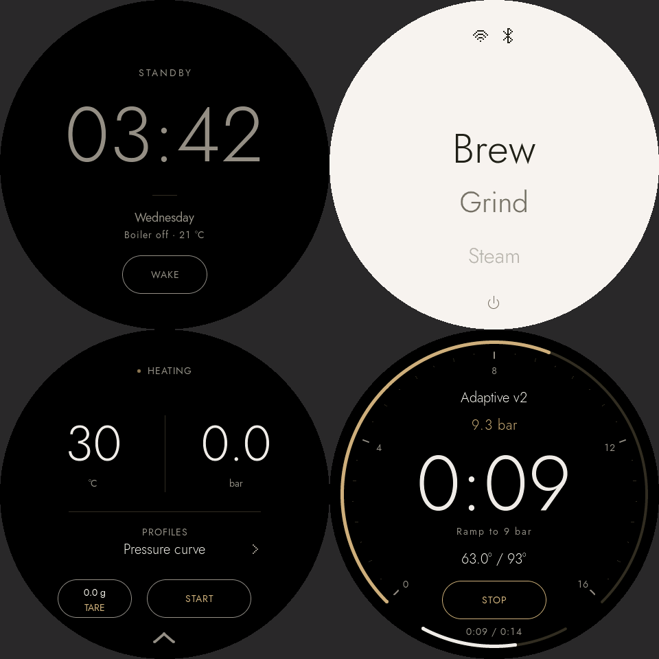

# Jost

The current minimal-luxury display and web UI use Jost by Owen Earl, with weights
300 for large type and 400 for small display labels. The web variable font supports
weights 100–900. Original Space Grotesk and JetBrains Mono sources remain for the
archived design system.

Source: [Google Fonts Jost](https://github.com/google/fonts/tree/main/ofl/jost),
`Jost[wght].ttf`, downloaded October 20, 2026 and losslessly compressed to
`Jost-Variable.woff2` with fontTools. License and attribution: [OFL-Jost.txt](../../../../design/fonts/OFL-Jost.txt).

`scripts/design/gen_luxury_assets.py` generates the LVGL fonts. It resolves Jost's
`tnum` OpenType feature into the static font's character map for steady clocks and
telemetry, and supplies the recipe arrow outline. The web uses the unmodified
variable outlines and CSS tabular numerals. `scripts/design/gen_web_assets.py`
copies this font and its license to `web/public/fonts` for offline use.

[Desktop web preview](web-desktop.png) · [Phone web preview](web-phone.png)

The warm ivory, black and champagne palette and existing display layouts remain.
Web readings use light type, with regular weights in compact controls. Jost is
also applied to chart labels and replay video exports. The font is preloaded from
the device with no dependency on Google Fonts at runtime.

Verified October 20, 2026:

- Simulator and LilyGo display firmware builds passed with the embedded web UI.
- 180 embedded web browser assertions passed with no runtime errors, including
  Jost loading, desktop/phone layouts and light/dark themes.
- Display appearance: 18 assertions; Steam/Water/Grind: 118; profile animation:
  34; Brew/profile editing: 38; phased brewing and frozen timer: 17.
- Navigation UI checks passed and all five connection QR images decoded correctly.
  Apple Vision decoding required running outside the sandbox.
- Tabular widths and the recipe arrow were checked in the generated font instance.
- Web lint passed with no errors and six existing Statistics hook warnings.

Browser verification used a disposable simulator with the `first`, `second` and
`bloom` profiles, recorded shot history and AMOLED (`theme=2`) initialized.
No physical display or controller was flashed for this update.
