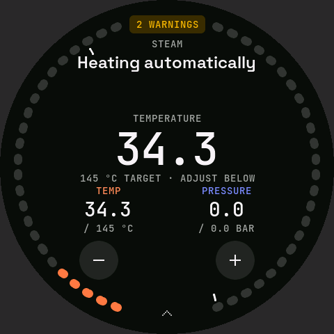
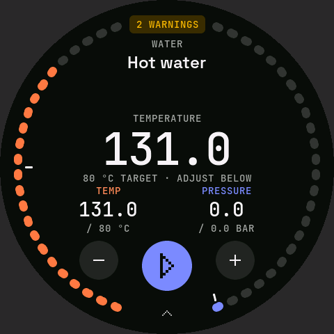
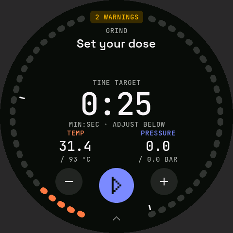
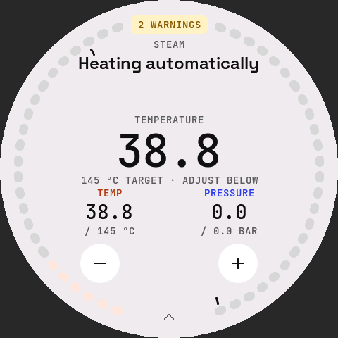
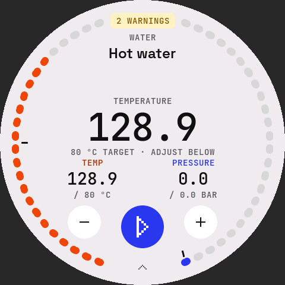
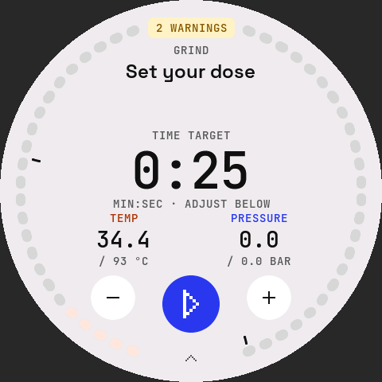
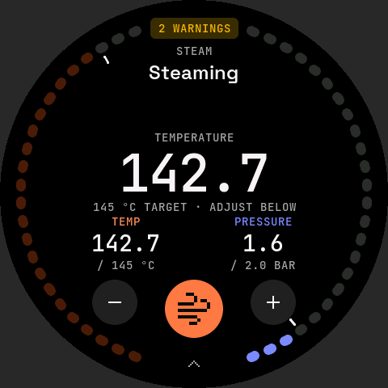
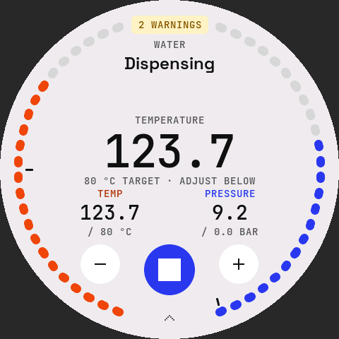
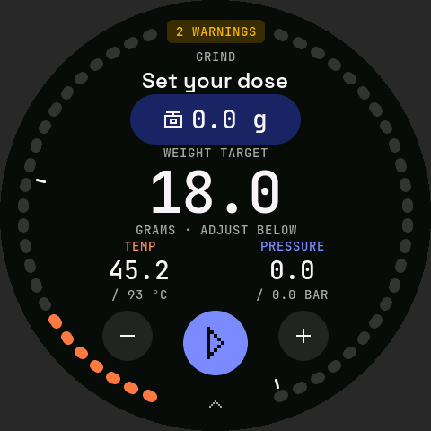

# Steam, Water and Grind

Implemented with one shared `ModeScreen`, preserving the stock controller actions and fixed gauge scales.
Steam starts automatically near its target and has no touch start control. Its heat-colored steam glyph appears
only while steaming. Water and Grind expose start/stop; Grind retains time/weight selection and long-press tare.
Temperature edits in these modes do not mark the Brew profile dirty.

`python3 scripts/verify_display_modes.py` passed **71 assertions** on 2026-10-03. Five isolated simulator cases
cover all three themes, automatic steam start, Water toggling, timed and weight Grind completion, upper/lower
target limits, Bluetooth scale loss, pressure-sensor fallback, Menu stopping a process, persisted temperature
settings and physical steam-button navigation. Captures and simulator logs are grouped by case here.

| Steam | Water | Grind |
|---|---|---|
|  |  |  |
|  |  |  |
|  |  |  |

No physical display has been flashed. The simulator cannot validate pump, valve, relay or scale hardware.
