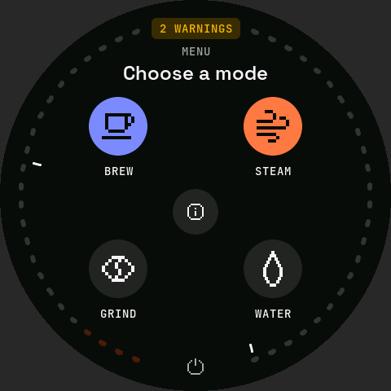
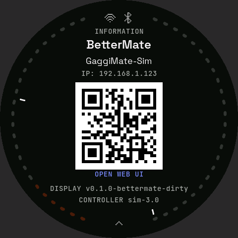
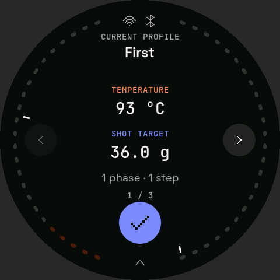
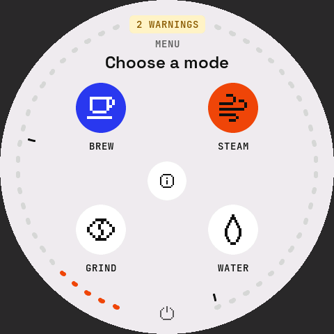
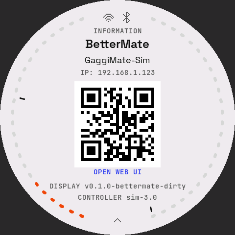
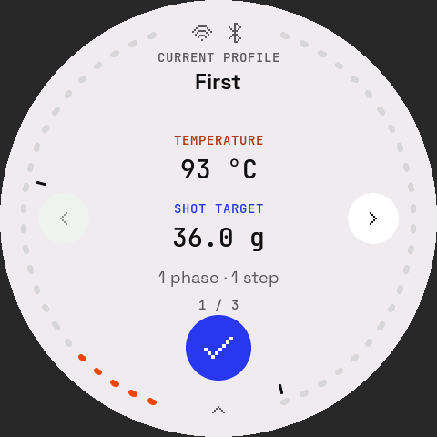
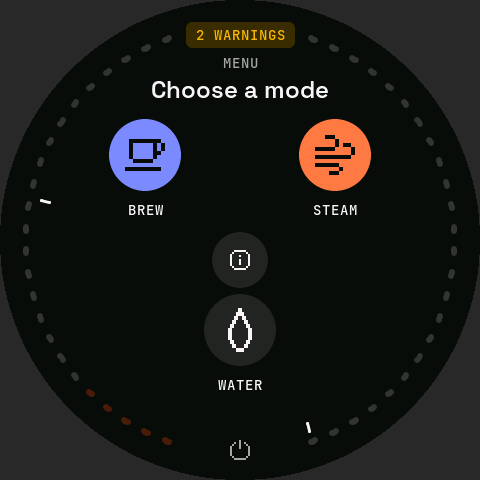
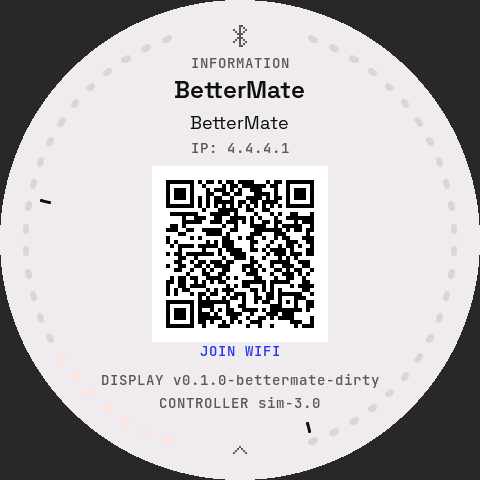
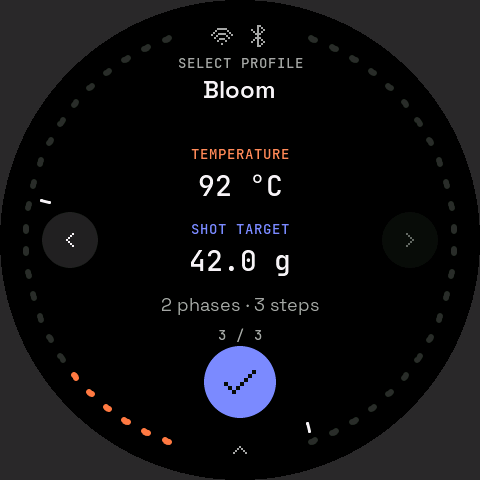

# Menu, Info and Profile

All nine real screens now have BetterMate implementations. Stock event subscriptions, tasks, routing, brightness
handling and EEZ infrastructure are retained: display cleanup is deferred at the user's request.

`python3 scripts/verify_display_navigation.py` passed **79 assertions** on 2026-10-03. Five isolated cases cover
three themes, conditional grinder availability, mode routing, standby/wake, disconnect guards, profile arrows
and horizontal/upward swipes, selected-first favorites without duplicates, list-end controls, profile facts,
selection persistence and clearing profile edits. Minimal screens use thinner ticks; the full temperature ring
and temperature reading remain available without a pressure sensor.

Info preserves network name/IP, display/controller versions and connectivity indicators. The verifier uses
macOS Vision to decode five actual rendered QR images: Wi-Fi URLs in three themes, WPA AP credentials including
all reserved-character escapes, and an open AP. Decoded values are recorded in `qr-decoded.json`; these are
isolated simulator test credentials. On other platforms, manually scan the captured Info codes.

| Menu | Info | Profile |
|---|---|---|
|  |  |  |
|  |  |  |
|  |  |  |

Physical hardware validation is still pending.
