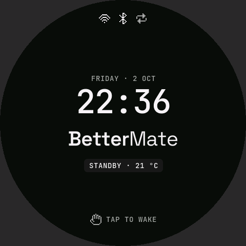
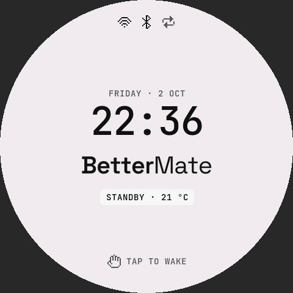
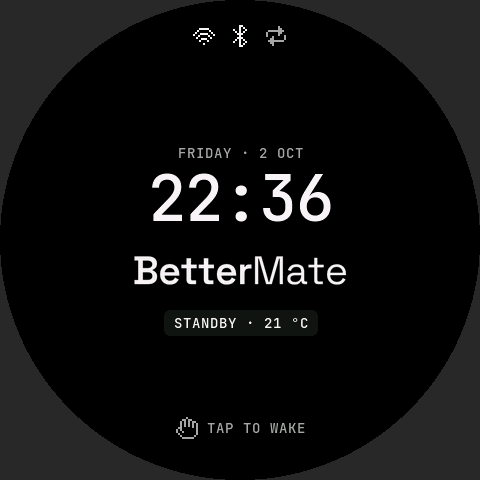

# Standby milestone — v0.1.0-bettermate

BetterMate now owns the Standby screen on the simulator and device builds. It reuses stock navigation and
machine event subscriptions while the other screens await their ports. The clock supports 12/24-hour time,
the hint shows the earliest enabled local wake schedule, and blocked machine states show their status without
allowing wake. AMOLED rests after 30 seconds and drifts 2 px per minute; warnings and faults keep the full screen
visible, and returning to Standby resets the rest timer.

| Dark | Light | AMOLED |
| --- | --- | --- |
|  |  |  |

## Validation

Run from the repository root:

```shell
pio run -e display-sim
pio test -e native -f test_bettermate_wakeup
python3 scripts/verify_display_standby.py
pio run -e display
```

The eight native tests cover schedule ordering, both Sunday/Monday conversions, a full weekly rollover,
the current minute, disabled days, malformed times, midnight, and 23:59.

The three simulator scenarios passed 43 assertions, capturing:

- All three themes, tap-to-wake without starting a process, Brew → Menu → Standby, and wake from the left edge.
- A 12-hour clock and wake schedule with a weekday, clock-only AMOLED rest, a one-minute drift, wake from rest,
  and the restored full Standby screen on return. Comparing the captured clock bounds confirmed a 2 px horizontal move.
- Disconnection, both directions of protocol mismatch, temperature runaway, unknown error, autotuning, OTA updating,
  and recovery. Taps in each blocked state kept the machine in Standby with no active process.

Captures and assertion logs are in the three directories beside this file. Their clock is the machine's default
Europe/Rome timezone. Colors have the panel's RGB565 quantization. The error/status copy comes from the initial
Standby implementation and is still available for review.

The final implementation built for LilyGo T-RGB at 3,612,061 bytes of flash (55.1%) and 94,208 bytes of static RAM
(28.7%). This is 66,260 bytes of flash above the original baseline. These measurements were taken before tagging;
the generated build version/timestamp can change the size slightly. No physical display was flashed or tested.

## Next

Port Brew and Status using the shared tick ring. The user chose 0–160 °C and 0–16 bar with target markers, and
the stock single 300° temperature ring remains required without a pressure sensor. Original design references
are preserved under `design/reference/`; behavioral parity remains defined by the workspace's `stock-screens.md`.
