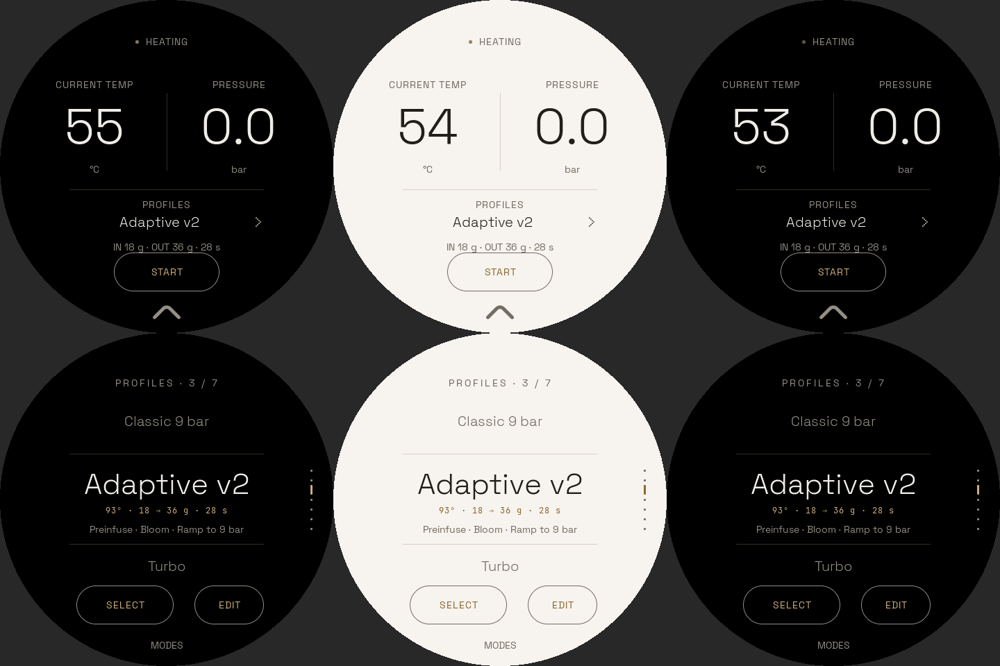
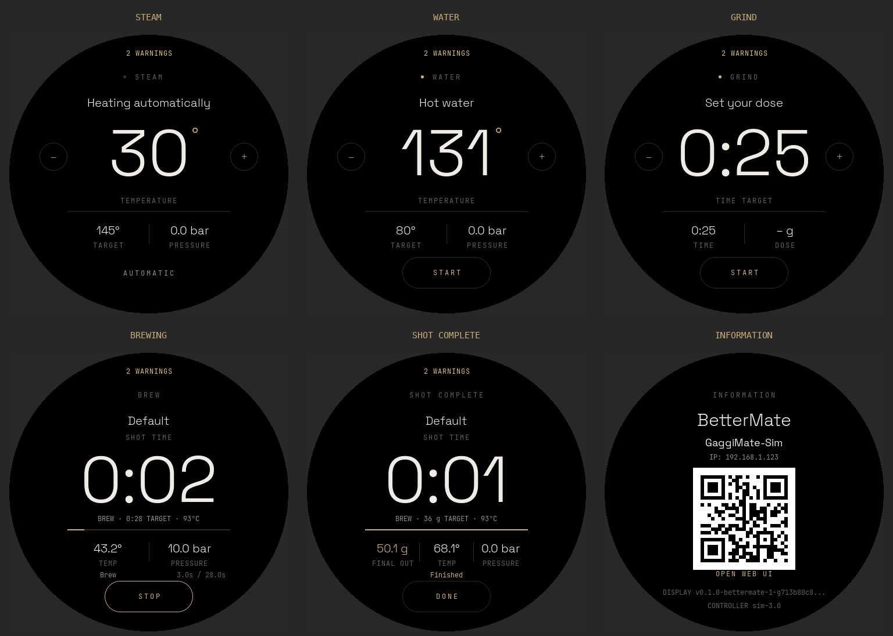
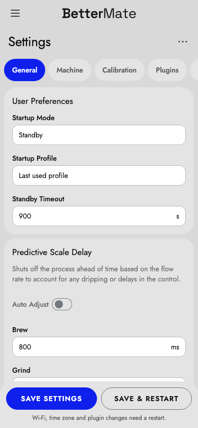

# BetterMate usability assessment — 6 October 2026

Implementation follow-up: [the usability fixes, verified previews and checks](ui-usability/README.md) address the findings below. This assessment preserves the original evidence and observed failures.

The minimal luxury direction works visually: the black ground, warm white figures, champagne accent and quieter composition improve the round display. The main usability losses come from removing visible controls, changing what the largest number means, and giving informative text unexpected actions. Keep the visual direction and repair the interaction components first.

This assessment covers the current `ui/minimal-luxury` working tree, its saved display renders, the existing web redesign, and the local GaggiMate `master` reference at `d9bc4d3e`. BetterMate's committed base is `713b80c8`; the luxury display changes are uncommitted. Stock display captures and the parity inventory describe the original v1.9.0 display. This comparison does not claim that the local upstream checkout is the latest online release.

Four interaction problems were reproduced in the existing simulator with disposable state and a headless SDL backend. Visual judgments use saved captures; the headless checks verify input and machine state, not panel rendering. Web findings use saved desktop/phone captures and source comparison. Live browser tools were unavailable in this session. Physical touch accuracy, viewing distance, glare and the real machine were not tested.

## Fix first

| Priority | Page/component | Evidence and user impact | Recommended change |
| --- | --- | --- | --- |
| P1 | Water readout and running-shot timer | **Reproduced:** start dispensing or brewing, then tap the large number at `(240,210)`. The UI opens Modes and the active process stops. Both figures look informational. The large invisible navigation target makes an ordinary tap abort an operation. | Remove navigation from numerical readouts. Use a visible Modes/Back control, and reserve the explicit Stop control for stopping. If opening Modes retains the stock stop behavior, make that consequence clear. |
| P1 | Navigation on working pages | The visible stock bottom chevron was replaced by an unmarked strip around `y=462`. The recipe and several other controls clear gesture bubbling. **Reproduced:** an upward swipe from Brew's recipe `(240,340)` to `(240,180)` stays on Brew. On Profile, swiping upward advances the wheel instead of opening Modes. | Restore one visible, consistent navigation control with a 56 px touch area. Gestures can remain shortcuts; they need reliable behavior wherever a gesture is expected. |
| P1 | Brew temperature and readiness | Brew renders `targetTemp` as the large `93°`, while Steam/Water render `currentTemp` in the same position. Brew has no live temperature or pressure reading on its idle page. A warning count replaces READY/HEATING, so a large `93°` plus `2 WARNINGS` can conceal the machine's heating progress. Stock Brew continuously exposes actual temperature and pressure. | Label target and current explicitly. Keep the editable target adjacent to its minus/plus controls, and show live temperature nearby. Keep readiness visible independently of warning count. Restore a compact pressure reading when available. |
| P1 | Profile wheel | **Reproduced:** at profile 3/7, Turbo and Bloom are the next two names; tapping Bloom's row moves to Turbo, profile 4/7. Both next rows share one one-step action; both previous rows also share one action. The outer names use the border color and nearly disappear. | Give each displayed row the action corresponding to its name, or show only one previous and one next row. Add a visible Back action and readable neighbors. Keep Select separate from browsing. |
| P1 | Text and control contrast | Essential labels use `faint`: nominal contrast is **3.40:1 on black** and **3.32:1 on ivory**. Profile outer names and button outlines use `line`: **1.53:1 dark**, **1.37:1 light**. This is weaker than the existing design system's 4.5:1 text and 3:1 meaningful-mark targets. The 12 px tracked labels make the problem more noticeable. | Use `muted` or stronger ink for operational labels; reserve faint/line for decoration. Give enabled controls a visible boundary or fill. Raise essential display labels toward 14–16 px. Preserve the quiet palette through spacing and hierarchy. |
| P1 | Mobile Settings navigation and footer | The saved phone render clips tab labels vertically. The floating navigation button covers part of Save Settings. These are visible layout failures despite the previous suite reporting no whole-page overflow. | Prevent each tab's contents from wrapping into a clipped second row. Give tabs enough width and allow horizontal scrolling. Move phone navigation into a header or allocate a separate footer lane. Keep Save fully clear. |
| P2 | Scale actions on Brew/Grind | Scale controls are 32 px high. Brew's recipe touch area spans `312–376`, scale spans `362–394`, and Start spans `383–437`: their input areas overlap. Tare requires an undisclosed long press. On Brew, target toggling retains the original action that has no visible Brew effect. | Allocate non-overlapping touch areas. Offer an explicit Tare action, possibly in a scale drawer. Show a visible Time/Weight selector only where it changes behavior. |
| P2 | Brew adjustment and unsaved changes | The plain IN/OUT/TIME row opens Adjust, replacing the stock visible gear. Immediate temperature nudges mark the profile dirty, but the idle page never displays `profileDirty`. Save/Done/Copy are only exposed after discovering the recipe tap area. | Add a small visible Edit recipe affordance and an unsaved indicator after a nudge. Use clear outcomes: Save, Keep for this session, Save a copy. |
| P2 | Web target adjusters | `Adjuster` and metric adjustment buttons retain 32×32 px controls. The icon swap puts fixed 24 px glyphs into these small controls. Compact metrics omit adjustment buttons entirely. This small-button problem is largely inherited from GaggiMate. | Use 44 px touch targets and accessible labels consistently. Preserve adjustment access in the phone layout, directly or through a labeled target editor. |
| P2 | Web icon meanings | Password visibility now uses the same search glyph in both states, replacing upstream eye/eye-slash. Profiles and History retain numerous small unlabeled visible action icons. Web modes also commonly render as icons alone. | Restore a meaningful password visibility icon/state. Label primary actions and modes; group secondary profile/history actions in a named More menu. |

P1 means a functional or readability problem to address before treating the design as finished. P2 means friction or inconsistency that should follow in the same usability pass. These are assessment priorities, not claims about machine safety failures.

## Display pages

| Page | Decision | Keep | Change |
| --- | --- | --- | --- |
| Standby | Keep; small readability pass | Large clock, weekday, warm palette, Wake, schedule and fault states | Strengthen essential status text and the Wake boundary. Preserve AMOLED rest/drift. |
| Modes | Keep; refine interaction | Written mode names improve on stock icons; live temperature/pressure; compact layout | Distinguish a mode being browsed from the machine's actual mode. A swipe changes the underline without changing the machine, while a tap enters immediately. Make Information an explicit discoverable action. |
| Brew idle | Rework hierarchy and controls | Profile name, recipe facts, restrained typography | Separate target/live readings; restore readiness; visible Modes and Edit; non-overlapping scale actions; show dirty state. |
| Brew Adjust | Keep the editor; improve entry and outcomes | Direct adjustment, Save, Done and Copy behavior | Make the entry visible and clarify temporary versus saved changes. Dose IN is displayed but currently has no corresponding field in this web profile editor; either provide an editable field or present it as optional metadata. |
| Profile | Rework the wheel interaction | Focused profile name and recipe preview | Correct row selection, strengthen neighbors, add visible Back. Show a long name sufficiently clearly to distinguish similar profiles. |
| Steam | Keep composition; repair control semantics | Heating/Steaming text and automatic operation explanation | Make it obvious that minus/plus edits the smaller target while the large value is live. Remove hidden navigation from the temperature. Provide a visible exit from Steam. |
| Water | Keep composition; fix immediately | Dispensing/Hot water text, target and pressure facts, Start/Stop | Remove hidden stop/navigation from the temperature and make target adjustment clearer. |
| Grind | Simplify active state | Target before starting, Start/Stop, time/weight modes | While running, prioritize actual progress or remaining time rather than an unchanged target. Make Time/Weight and Tare explicit; remove hero navigation and small overlapping scale targets. |
| Shot progress/completion | Keep structure; fix immediately | Timer, named phase, target, output/temperature/pressure, completion and calibration states | Remove timer navigation; keep Stop dominant; strengthen phase/readout labels. Preserve the distinction between pump stopped and calibration complete. |
| Information | Keep; add navigation | High-contrast QR with quiet zone, network/IP, offline state | Add visible Back. Keep versions legible; long development versions can remain truncated if full diagnostics are available elsewhere. |

The stock rings are visually loud, but they carry continuously available live telemetry and target markers. Removing them is compatible with the luxury direction if compact live readings replace their information. Their visual absence should not also remove the user's ability to understand the machine.

## Web pages

The web redesign still uses blue/purple primary actions, orange heat colors, pixel glyphs, dense card internals and the upstream dashboard layout. It is an earlier design language than the black/ivory/champagne round display. Applying luxury colors alone will not resolve the mobile and interaction issues.

| Page | Assessment | Recommended treatment |
| --- | --- | --- |
| Dashboard | Mostly upstream information architecture with a visual refresh. The large graph dominates desktop while actions and readings remain small. Mode and start controls are largely icon-only. | Give machine state, chosen recipe and a labeled Start/Stop the primary hierarchy. Keep a readable chart as supporting information and preserve the advanced view. |
| Profiles | Large cards with sparse useful facts and a long multicolor action strip. Selection, favoriting, editing, exporting and deleting compete for attention. | Show a readable recipe summary; retain Select/Edit as clear actions; group secondary actions. Expand phase detail when needed. |
| Profile Edit | Core editor structure and machine-control contract are retained. This review did not exercise a new end-to-end save. | Keep the richer phase editor functional, use clearer section hierarchy, and add the new dose metadata field if IN is meant to be user-editable. |
| Shot History | Useful compact rows, but repeated small icons still require learned meanings. | Keep scanning and analysis access fast; use a labeled Analyze action and a secondary menu. |
| Shot Analyzer | The dense analytical view has a valid purpose. Replacing its plots with decorative whitespace would hurt use. | Retain detailed charts, compare and replay; simplify toolbars, make labels and selection states readable, and use progressive disclosure for lesser-used controls. |
| Statistics | Many simultaneous cards and range panels. The design still reads as a technical dashboard. | Lead with a small set of meaningful summaries, then charts/tables. Retain detailed per-profile/per-phase views. The synthetic capture's date/data values are not evidence of a production data bug. |
| Settings | Desktop structure remains useful. Mobile tabs and footer need repair. Password glyph is a redesign regression. Display Theme is blank in the saved render; its selector offers only 0/1 although display theme 2 exists. The two-option selector is also in upstream. | Fix mobile chrome first. Restore password semantics. Verify how theme 2 is mapped and ensure every supported current value is visibly represented. Keep an explicit choice between Save and Save & Restart. |
| Dashboard Settings | Useful advanced customization, largely retained from upstream. | Keep it separate from everyday machine controls. Ensure reorder controls remain usable on touch without requiring drag. |

Original web references: [dashboard](../../visual-identity/_ascii-names/current-1.png), [advanced dashboard](../../visual-identity/_ascii-names/current-2.png). These are historical captures, so differences in live machine values are not comparisons of operating behavior.

## Shared components to establish

1. **Visible navigation:** a consistent Back/Modes control on every non-home display page; phone navigation clear of action footers.
2. **Reading plus target control:** explicit labels for actual versus target; minus/plus physically associated with the edited value.
3. **Action button:** at least 56 px display / 44 px web touch targets. Start and Stop should be immediately recognizable, with clear enabled/disabled states.
4. **Machine status:** readiness plus the most important warning, simultaneously. Use wording and severity, not only a dot or count.
5. **Recipe selector/editor:** browsing, selection and editing should have distinguishable entry points and outcomes.
6. **Scale controls:** readable live weight, explicit tare/target-type actions, and space separate from Start.
7. **Palette and icon rules:** one black/ivory/champagne interface palette across surfaces; retain distinct named chart series and error/warning colors. Choose a consistent icon treatment that suits the lighter typography, and retain text labels where the glyph is ambiguous.

For the display, the existing `muted` token provides nominal text contrast of 6.44:1 on black and 4.59:1 on ivory. It is a practical starting point for stronger operational labels. Keep the darker line token for decorative dividers. Preserve the supported light/AMOLED themes and QR contrast.

## Verification and source evidence

The headless simulator reproduced these four cases with the real LVGL input dispatch and mocked controller:

| Case | Initial state and action | Observed result |
| --- | --- | --- |
| `water-readout-stops` | Water screen 6, active=1; tap `(240,210)` | Modes screen 4, active=0 |
| `shot-timer-stops` | Shot screen 3, active=1; tap `(240,210)` | Modes screen 4, active=0 |
| `profile-second-neighbor` | Classic 9 bar, 3/7; Turbo/Bloom visible; tap Bloom row at `(240,355)` | Turbo, 4/7 |
| `brew-swipe-on-recipe` | Brew screen 2; swipe `(240,340)` → `(240,180)` | Remains on screen 2 |

Test logs and disposable fixtures are in `/var/folders/r2/nnr0mbnx4kv380g5h7y4m9gh0000gn/T/bettermate-usability-20261006-2scrh4qs/`. No machine was operated and no firmware was flashed.

Key source references:

- [Mode hero navigation](../src/display/ui/bettermate/screens/ModeScreen.cpp), [shot timer navigation](../src/display/ui/bettermate/screens/StatusScreen.cpp), and [Menu action](../src/display/ui/bettermate/BetterMateUI.cpp): readout → Menu → deactivate and set Brew mode.
- [Brew](../src/display/ui/bettermate/screens/BrewScreen.cpp): hidden recipe editor, target hero, scale geometry, warning/readiness substitution and faint labels.
- [Profile wheel](../src/display/ui/bettermate/screens/ProfileScreen.cpp): two previous/next names share one action. [UiState collection](../src/display/ui/bettermate/BetterMateUI.cpp) supplies neighbor offsets −2, −1, +1, +2.
- [Luxury palette](../src/display/ui/bettermate/LuxuryUI.cpp): nominal contrast calculations above use the source sRGB values, before panel conversion and rendering.
- [Working frame](../src/display/ui/bettermate/screens/WorkingScreen.cpp): invisible bottom navigation, small warning target and gesture handling.
- [Web tabs](../web/src/components/TabBar.jsx), [phone navigation](../web/src/index.jsx), [Settings footer](../web/src/pages/Settings/StickyFormFooter.jsx), [General settings](../web/src/pages/Settings/tabs/GeneralTab.jsx), [adjusters](../web/src/pages/Home/Adjuster.jsx) and [metric controls](../web/src/pages/Home/cards/MetricsGrid.jsx).

The existing suites verify many reachable functions, supported states and absence of page-level overflow. They do not establish that controls are discoverable, that every visible profile name maps to the correct action, that touch regions do not overlap, or that a readout cannot accidentally stop a process. Those behaviors should become explicit acceptance criteria in the usability pass.

## Visual evidence

**Original Brew and minimal luxury Brew/Profile**

**Minimal luxury operating pages**

**Phone Settings: clipped tabs and navigation overlapping Save**

