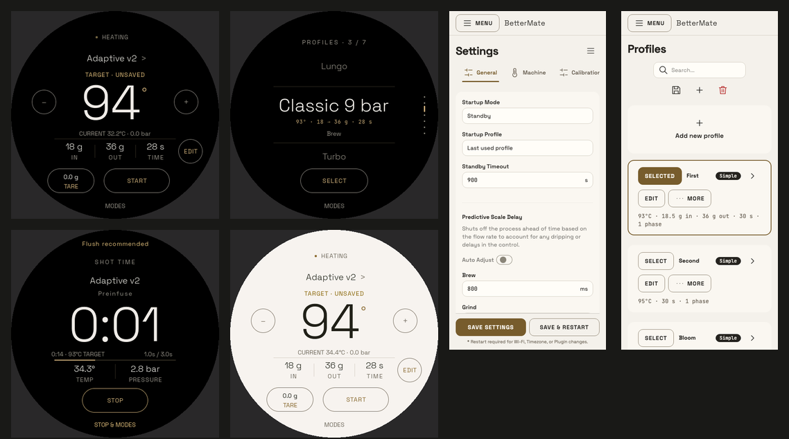

# Minimal luxury usability fixes

Implemented locally on `ui/minimal-luxury`, following the [October 6 assessment](../ui-usability-assessment.md).
The existing display redesign and its uncommitted profile metadata changes were preserved.
The [October 10 Brew and Profiles continuation](../display/minimal-luxury/brew-profiles/README.md) supersedes
the earlier Brew target layout: its large readings are live, and target editing belongs to Profiles.



## Display

- Informational temperatures and shot timers no longer open Modes or stop a process.
- Every working page has visible navigation with a 56 px target. While running, it reads **STOP & MODES**;
  upward swipes leave the process running. Idle swipes work from recipe and adjustment controls.
- Brew shows large live temperature and pressure readings. Steam and Water label their large temperature as
  the target, with current values below. Brew preserves readiness alongside the highest-priority warning.
- Operational labels use the bundled 14 px font and stronger colors. Outlines use the readable neutral;
  low-contrast lines are decorative. Heating animates through LVGL instead of relying on the slow idle refresh.
- The profile wheel displays one neighbor in each direction with a matching 56 px action. Long focus names scroll.
- Profiles exposes Select and Edit, then Save / Session / Copy for target changes. Brew shows UNSAVED;
  Session keeps changes active without saving them.
- A connected scale has an explicit Tare button, separate from Start and recipe editing. Grind exposes
  Use Time / Use Weight and shows remaining time or actual ground weight while running.
- The shot phase, target and telemetry have separate rows clear of Stop. Completion and calibration behavior,
  guarded confirmation, hold-to-flush, AMOLED clock rest/drift and the QR quiet zone remain functional.
- The Modes page names Information and explains that tapping a browsed mode opens it.

## Web

- Warm ivory / black / champagne, stroke icons and readable outlines now match the display direction.
  Temperature, pressure, flow and weight chart series retain distinct colors.
- All machine modes and Start / Stop / Done have visible labels. Target adjusters remain available in compact
  metrics, with 44 px targets. Dashboard controls occupy more desktop width and live values are larger.
- Phone navigation lives in a header; Settings tabs stay on one line and scroll horizontally. Save and
  Save & Restart have full touch targets clear of navigation.
- Password visibility has eye/eye-off icons, Show/Hide labels and a selected state. Display Theme represents AMOLED.
- Profile cards show their recipe summary with Select, Edit and More. Phone cards allocate separate action rows
  so names stay readable. Phase charts/details and existing reorder controls remain available.
- History exposes Analyze and groups export/upload/delete under More, retaining deletion confirmation.
- The optional coffee dose is editable in both standard and pro profile forms. It survives save/reload and
  remains recipe metadata; it does not set a grinder or machine-control target.
- Analyzer touch controls expand to 44 px on touch devices. Detailed analysis, Statistics and dashboard
  customization remain available and use the shared palette.

## Verification

| Check | Result |
| --- | --- |
| Usability interaction regressions | 58 assertions passed: Water/shot readout taps, active swipes, recipe swipes, wheel mapping, explicit Tare/Edit/Save/Session, grind progress |
| Brew/Status suite | 132 assertions passed, including save/copy, timed/volumetric/phased shots, sensor fallback, warnings, flush, heating animation and frozen completion timer |
| Steam/Water/Grind suite | 95 assertions passed |
| Standby/Modes/Brew/Profile luxury suite | 125 assertions passed, including three themes, wake guards and AMOLED rest/drift |
| Navigation | 71 assertions passed; all five actual QR renders decoded correctly, for 76 total |
| Final shot and warning layout checks | 15 assertions each passed after the last spacing and named-warning changes |
| Web browser suite | 180 assertions passed against the development server and another 180 against the final embedded firmware bundle, both with no runtime errors; desktop, phone, landscape, all Settings tabs, Analyzer and Statistics |
| Web lint | Passed with six existing Statistics hook warnings; no errors |
| Web production build | Passed |
| Simulator and display firmware builds | Passed; firmware uses 3,771,653 bytes flash (57.6%) and 94,288 bytes static RAM (28.8%) |
| Embedded web bundle | 53 unique assets, 543,520 bytes; HTML/JS/CSS gzipped |

The browser checks explicitly verify that phone tab contents fit, Save is reachable and unobstructed,
profile names fit their allotted space, password state changes, AMOLED is represented, and dose persists.
Display scripts use real LVGL input and rendering, mocked machine control, isolated preferences and synthetic profiles/history.
The SDL driver now falls back to software rendering so these screenshots also work headlessly.

The final firmware and simulator include the web bundle. No firmware was flashed and no physical machine was operated.
Physical touch accuracy, glare and viewing distance still need a panel check.

Run from the repository root after building the simulator:

```sh
SDL_VIDEODRIVER=dummy python3 scripts/verify_display_usability.py
SDL_VIDEODRIVER=dummy python3 scripts/verify_display_luxury.py
SDL_VIDEODRIVER=dummy python3 scripts/verify_display_brew.py
SDL_VIDEODRIVER=dummy python3 scripts/verify_display_modes.py
```

Full test logs and additional renders are in `/tmp/bettermate-usability-*`. Selected durable previews and
[development web results](web-checks.json) and [embedded web results](embedded-web-checks.json) are saved here. [Phone Settings](phone-settings.png),
[phone Profiles](phone-profiles.png), [phone Analyzer](phone-analyzer.png),
[light dashboard](dashboard-light.png) and [dark dashboard](dashboard-dark.png) show the web changes.
