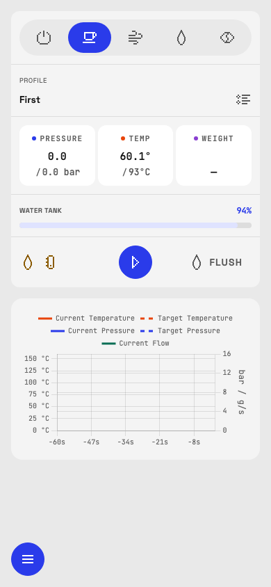

# BetterMate web UI

Implemented and verified on 2026-10-03 using `design/reference/web-ui.md`. Light and dark themes, Space Grotesk,
JetBrains Mono, native wordmarks, PWA marks and 46 pixel glyphs come from the immutable `design/` sources through
`scripts/design/gen_web_assets.py`. Cards and popups use flat surfaces, navigation/tabs/mode controls are 44 px,
SVG icons retain their 24 px grid, readings use mono figures, and selected profiles have primary borders and chips.
Charts and replay exports follow the shared colors and typography. Font Awesome dependencies were removed.

Machine control, profiles, settings, calibration, OTA and analyzer/statistics APIs are retained. The internal
`gaggimate` source tags, storage keys, mDNS/MQTT/HomeKit identifiers and upstream attribution remain intact.
Legacy Coffee/Nord theme preferences resolve to dark/light; System follows OS changes. Missing initial
water-level readings remain hidden until valid.

| Desktop light | Desktop dark |
|---|---|
|  |  |
|  |  |

| Phone | Analyzer |
|---|---|
|  |  |

The remaining PNGs cover Advanced dashboard, active Brew/Water/Grind, Steam, profile editing, all Settings tabs,
history, loaded statistics, navigation and portrait/landscape phone layouts. These are synthetic simulator
profiles and shots. Captures in this directory come from the final embedded production bundle.

## Verification

`scripts/verify_web_ui.mjs` passed **173 assertions** against Vite (`results.json`) and again against the rebuilt
simulator's embedded production bundle (`results-embedded.json`), with zero browser runtime errors. It checks:

- Desktop 1440×1000, phone 390×844 and phone landscape 844×390 layouts; fonts, native icon sizes, flat cards,
  absence of page overflow and invalid readings.
- Dashboard, profiles/edit, Settings and every tab, history, analyzer/loaded shot, statistics/build and dashboard settings.
- Live temperature target adjustment, mode acknowledgments, Water/Grind start/stop, Brew confirmation/start/stop/clear,
  favorite profile selection and phone navigation.
- Light/dark, legacy theme values, retained storage keys, and System responding to OS appearance changes.

`npm run lint:check` has no errors and six existing hook warnings in Statistics (`lint.log`). `scripts/build_webui.sh`
passed (`web-build.log`), packing **53 assets / 541,922 bytes**, including both WOFF2 fonts and PWA metadata.
`pio run -e display-sim -e display` passed (`firmware-build.log`). The device uses **3,658,733 bytes of flash (55.8%)**
and **94,208 bytes of static RAM (28.7%)**. Generated version/time strings can shift these sizes slightly.

## Reproduce

Run the verifier only against a disposable local simulator: it changes modes and targets and records synthetic shots.
It expects the `first`, `second` and `bloom` favorite profiles from the display navigation fixtures, and existing history.
From the repository root, prepare a fresh scratch directory:

```sh
python3 - <<'PY'
import json
import sys
from pathlib import Path
sys.path.insert(0, 'scripts')
from verify_display_navigation import PROFILES
scratch = Path('/tmp/bettermate-web-review')
scratch.mkdir(exist_ok=False)
profiles = scratch / 'sim_data/littlefs/p'
profiles.mkdir(parents=True)
for profile in PROFILES:
    profile = dict(profile, description='Simulator review profile')
    (profiles / f"{profile['id']}.json").write_text(json.dumps(profile))
nvs = scratch / 'sim_data/nvs'
nvs.mkdir(parents=True)
(nvs / 'controller.json').write_text(json.dumps({'sp': 'first', 'fp': 'first,second,bloom'}))
PY
scripts/build_webui.sh
pio run -e display-sim
```

Start the simulator from that scratch directory, using the repository's absolute binary path. This script wakes,
records a timed shot, acknowledges it and keeps the API available for an hour:

```sh
SIM_HTTP_PORT=8090 /absolute/path/to/bettermate/.pio/build/display-sim/program \
  --script 'wait 3000; tap 240 240; wait 500; tap 240 382; wait 32000; tap 240 386; wait 3600000; quit'
```

After the shot has finished, run from the repository root with an installed Playwright module:

```sh
node scripts/verify_web_ui.mjs --playwright-module /absolute/path/to/playwright/index.mjs \
  --url http://127.0.0.1:8090/ --output /tmp/bettermate-web-results
```

For Vite checks, run `SIM_HTTP_PORT=8090 npm run dev -- --host 127.0.0.1` from `web/` and omit `--url`.
Stop the simulator when finished. Display script suites use separate ports so they cannot receive browser API requests.
No physical display or controller was flashed; panel and machine hardware validation remains pending. Display cleanup
is deferred at the user's request, with DefaultUI/EEZ and the build flag retained.
