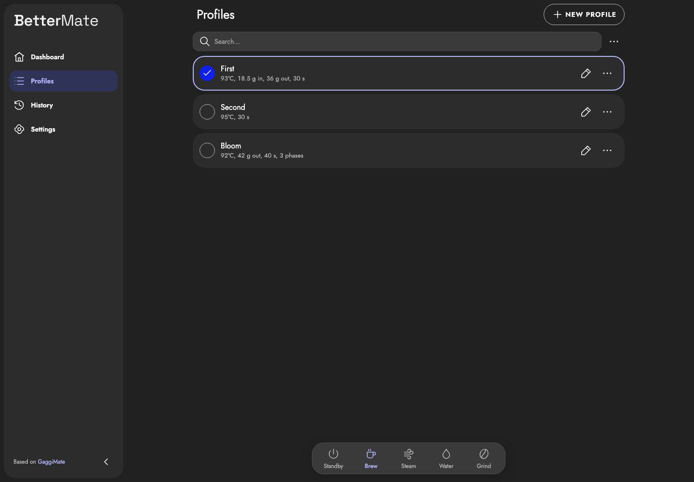
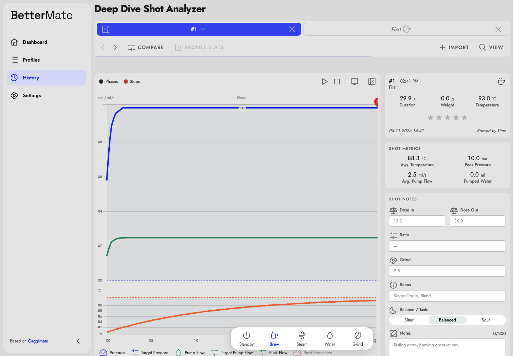

# BetterMate web UI

## Machine layout (2026-11-08)

The layouts follow the phone-app references the user shared on November 8: one machine card,
one action banner, a compact reading grid, grouped option tiles, list rows and pinned actions. Jost is unchanged.

The same day the user asked to declutter the result against those references. The first pass had taken their layout
but kept the old density: the phone dashboard showed the target temperature five times, zero readings at rest, up to
three charts and nine cards, where the reference has four blocks. The rule since then is that each fact appears once,
readings at rest stay off the screen, and Advanced view keeps everything.

| Phone | Finished shot | Desktop | Setup |
|---|---|---|---|
|  |  |  |  |

- **Shell:** phones get a top bar (menu or back, centered wordmark, a warning icon only away from the dashboard and only
  for warnings that are not next-shot reminders) and a bottom bar with the machine modes. Desktop and tablets get a
  floating sidebar with four pages (Dashboard, Profiles, History, Settings) and the same mode bar floating over the
  bottom of the content. Below 501 px of height a floating bar would cover too much, so phone landscape keeps the modes
  in its rail. Exactly one set of mode controls shows at any window size. The profile editor and Settings hide the bar
  for their pinned actions.
- **Dashboard:** `pages/Home/machine/`. All wording per machine state lives in `machineView.js`, including what the dial
  shows on each screen.
- **Views:** Simple and Advanced use this dashboard. Simple charts only a running or finished shot, and shows only the
  readings that can change what you do next (`simpleStatIds` in `StatGrid.jsx`). Advanced adds every reading, its target,
  the live chart between shots and the profile curve. Customize keeps the arranged panel layout, including its own mode
  selector. The picker is in Settings, General, Web Settings. Opening Dashboard Settings selects Customize, as it did before.
- **Other pages:** Profiles and History use one-line rows with a single menu. Settings, the profile editor and Dashboard
  Settings share the same titles, groups, segmented tiles and pinned actions. The analyzer and Statistics only picked up
  the shared title and card styles, and now sit under History in the menu.
- **Setup:** `/setup` opens once when the machine has no Wi-Fi name, and is reachable from Settings. There are no
  accounts, so the references' account screens have no equivalent.

## Live dial

The machine card used to hold a drawing of an espresso machine. It now holds a live dial in the same form as the round
display (`MachineDial.jsx`): scales on the rim, one reading in the middle. Temperature and pressure live on the dial and
leave the readings grid in Simple, so each still appears once. Advanced keeps them in the grid too.

| Screen | Rim | Centre | Answers |
|---|---|---|---|
| Standby | Temperature, greyed | Boiler temperature, next scheduled wake | Is it warm, and when does it wake? |
| Brew, heating | Temperature and pressure | Boiler temperature, "Ready in about 40 s" | How long until I can pull a shot? |
| Brew, ready | Temperature and pressure | Boiler temperature, shot plan (`18 g in, 36 g out, 30 s`) | What will this shot do? |
| Pulling a shot | Temperature and pressure | Timer, temperature, pressure | How far along, and is it on target? |
| Shot finished | Temperature and pressure | Final time, yield, ratio | How did it go? |
| Flush | Temperature and pressure | Elapsed time, pressure | Is it running? |
| Steam | One temperature ring | Boiler temperature, time to ready | Hot enough yet? |
| Water | One temperature ring | Boiler temperature, ml pumped | How hot, and how much? |
| Grind | Progress ring | Target between −/+, then progress against it | How much, and how far? |

Rules behind it, each taken from the firmware rather than assumed:

- **Fixed scales and notches.** 0–160 °C and 0–16 bar with target notches, as on the display. A machine without a pressure
  sensor gets the single temperature ring, as does Steam and Water.
- **Water has no timer.** The firmware only reports elapsed time for brew and grind. It does report `wp`, which
  `Controller::activate` zeroes at the start of every process, so during Water it is the millilitres pumped since you
  pressed start. Relay-only controllers report 0, and the line stays hidden.
- **Yield.** A shot stopped by weight reports the volume it measured (`pp`); a timed shot uses the scale. The ratio needs a
  dose on the profile. The results card then only adds what the dial doesn't show: max pressure and average flow.
- **Time to ready** is an estimate from the last 20 seconds of climb. It falls back to "9° to go" when the boiler isn't
  climbing steadily, and has only been seen against the simulator's boiler model.
- **Grind's target is set on the dial**, between −/+, as on the display. Stop by stays in its own group. The firmware shares
  one stop-by setting between Brew and Grind, so changing it on either screen changes both.

## Palette

The user supplied these colors the same day, for both modes. They replace the ivory, black and champagne palette on the
web UI only; the round display keeps its own theme. The tokens are in `web/src/design/luxury.css`.

| Role | Light | Dark |
|---|---|---|
| Page | `#d9d9d9` | `#212121` |
| Card | `#e4e4e4` | `#2c2c2c` (derived) |
| Tile, input, nav bar | `#ffffff` | `#3a3a3a` (derived) |
| Ink / muted | `#111111` / `#555555` | `#ffffff` / `#b8b8b8` |
| Line | `#b8b8b8` | `#4a4a4a` (derived) |
| Accent fill | `#0f20ec` | `#0f20ec` |
| Heat mark | `#e95b2a` | `#e95b2a` |
| Accent as text (`--primary-text`) | `#0f20ec` | `#b4b9ff` |
| Heat as text, warnings (`--heat-text`) | `#a0380e` | `#ff9a70` |

The values were read off the user's screenshots by eye, because the files were gone before they could be sampled, so
they may be a few units out. The fills and marks use the palette exactly. The two text tints exist because the palette
colors fail 4.5:1 as small text: cobalt on dark is 1.6:1, and orange is 2.8:1 on the light card and 4.0:1 on the dark
card. Cobalt on a dark surface also fails as a thin line, so selection borders and toggles use the tint in dark mode. Green status dots and red
destructive states stay as they were, because the palette has no equivalent.

Gauges follow the user's reference: the whole scale is a soft gradient, a mark shows the value and a notch shows the
target. `temp` runs blue to orange (temperature, pressure), `level` runs red to periwinkle (water tank) and `fill` runs
green to orange (flow, weight). Advanced's power and puck readings use a neutral grey.

Where things moved, so nothing is lost:

| Was | Now |
|---|---|
| Flush tile beside the action banner | Corner of the machine card, visible whenever a flush is possible |
| Target temperature repeated on the banner, profile tiles and readings | One stepper in the setup group; the gauge notch still marks the target |
| Flow, pump power and target notes in the readings at rest | Flow appears during a shot; all of it stays in Advanced |
| Live chart and profile curve at all times | Live chart during and after a shot; both stay in Advanced |
| Flush and temperature warnings in every mode | Flush only in Brew. Temperature not in Grind, nor while the status line already says the boiler is off target |
| Dashboard view pencil in the sidebar | Settings, General, Web Settings, which also holds Dashboard Layout under Customize |
| Shot Analyzer and Statistics in the menu | Links at the top of Shot History; the menu marks them as History |
| GitHub and Discord icons in the sidebar | Settings, System & Updates |
| Profile Select/Edit/more pills and type badge | Tap the row to select; pencil and menu at the end of the row; only Pro is marked |
| Profile details chevron | Row menu, Show details (description, reordering, phases) |
| Export all, Import, Delete all icons | Menu beside the profile search |
| Add new profile row | New profile button in the page header |
| Shot Analyze/More pills, id and "Not rated" | Arrow and menu at the end of the row; the id moves into the details and only real ratings show |
| Empty shot-note fields | Only what was written shows; Add notes opens the full form |
| Mode bar and Save bar both on Settings | Save bar only |
| Machine drawing | Live dial |
| Temperature and pressure in the readings | On the dial; both stay in Advanced's readings too |
| Stops-at weight on the action banner | In the shot plan on the dial |
| Time and weight in the shot results | On the dial |
| Grind target stepper in its own card | On the dial |

Behavior worth keeping:

- `req:change-mode` stops the running process on the firmware, so the other modes lock while a process runs.
  Steam never locks, because it runs for as long as the mode is selected.
- Slow state reaches the page a tick before telemetry. Until the first reading the dashboard shows
  "Reading the machine" and blanks its values instead of showing 0° as ready. A running process keeps Stop.
- The web Stop clears immediately (`deactivate` + `clear`), so Done and shot results appear only when a shot
  ends by itself.
- A blank password on the same network keeps the saved one, because setup leaves that field out of the save.

Implemented and verified on 2026-10-03 using `design/reference/web-ui.md`. Light and dark themes, Space Grotesk,
JetBrains Mono, native wordmarks, PWA marks and 46 pixel glyphs come from the immutable `design/` sources through
`scripts/design/gen_web_assets.py`. Cards and popups use flat surfaces, navigation/tabs/mode controls are 44 px,
SVG icons retain their 24 px grid, readings use mono figures, and selected profiles have primary borders and chips.
Charts and replay exports follow the shared colors and typography. Font Awesome dependencies were removed.

Machine control, profiles, settings, calibration, OTA and analyzer/statistics APIs are retained. The internal
`gaggimate` source tags, storage keys, mDNS/MQTT/HomeKit identifiers and upstream attribution remain intact.
Legacy Coffee/Nord theme preferences resolve to dark/light; System follows OS changes. Missing initial
water-level readings remain hidden until valid.

| Desktop light | Desktop dark |
|---|---|
|  |  |
|  |  |

| Phone | Analyzer |
|---|---|
|  |  |

The remaining PNGs cover Advanced dashboard, active Brew/Water/Grind, Steam, profile editing, all Settings tabs,
history, loaded statistics, navigation and portrait/landscape phone layouts. These are synthetic simulator
profiles and shots. Captures in this directory come from the final embedded production bundle.

## Verification

`scripts/verify_web_ui.mjs` passed **321 assertions** against Vite (`results.json`) and again against the rebuilt
simulator's embedded production bundle (`results-embedded.json`), with zero browser runtime errors. It checks:

- The floating mode bar (position, every page scrolling clear of it, one set of mode controls at 11 window sizes),
  the bottom mode bar, mode locking during a shot, Wake, Customize and Simple, pinned editor actions, segmented
  controls staying inside their cards, the action being on screen at phone sizes, a closed drawer on first load,
  320 px width, readings held back until telemetry, and the setup flow.
- What Simple promises: no chart between shots, no resting zeros, no repeated target, a chart only during and after a
  shot, Flush working from the machine card, and every moved action still one step away. Advanced keeps its chart and targets.
- What the dial promises on each screen, and that its text fits inside the ring at 320 px, 390 px, 1440 px and in phone
  landscape. The next wake and the pumped water use injected data, because the simulator has no schedule set and its mock
  controller always reports 0 ml.
- Desktop 1440×1000, phone 390×844 and phone landscape 844×390 layouts; fonts, native icon sizes, flat cards,
  absence of page overflow and invalid readings.
- Dashboard, profiles/edit, Settings and every tab, history, analyzer/loaded shot, statistics/build and dashboard settings.
- Live temperature target adjustment, mode acknowledgments, Water/Grind start/stop, Brew confirmation/start/stop/clear,
  favorite profile selection and phone navigation.
- Light/dark, legacy theme values, retained storage keys, and System responding to OS appearance changes.

`npm run lint:check` has no errors and six existing hook warnings in Statistics (`lint.log`). `scripts/build_webui.sh`
passed (`web-build.log`), packing **56 assets / 611,015 bytes**. `pio run -e display-sim -e display` passed
(`firmware-build.log`). The device uses **3,838,157 bytes of flash (58.6%)** and **94,312 bytes of static RAM (28.8%)**.
Generated version/time strings can shift these sizes slightly.

Not covered: this ran in Chromium only, with phone emulation, so iOS Safari safe areas and address-bar behavior are
unchecked. The setup save is mocked because a real save restarts the machine, which exits the simulator, so joining a
real network and the hotspot fallback are untested end to end. `phone-finished.png` and the scale states were checked
separately on a simulator started with `scale 1`, because the suite's simulator has no scale. Nothing was flashed.

## Reproduce

Run the verifier only against a disposable local simulator: it changes modes and targets and records synthetic shots.
It expects the `first`, `second` and `bloom` favorite profiles from the display navigation fixtures, and existing history.
From the repository root, prepare a fresh scratch directory:

```sh
python3 - <<'PY'
import json
import sys
from pathlib import Path
sys.path.insert(0, 'scripts')
from verify_display_navigation import PROFILES
scratch = Path('/tmp/bettermate-web-review')
scratch.mkdir(exist_ok=False)
profiles = scratch / 'sim_data/littlefs/p'
profiles.mkdir(parents=True)
for profile in PROFILES:
    profile = dict(profile, description='Simulator review profile')
    (profiles / f"{profile['id']}.json").write_text(json.dumps(profile))
nvs = scratch / 'sim_data/nvs'
nvs.mkdir(parents=True)
(nvs / 'controller.json').write_text(json.dumps({'sp': 'first', 'fp': 'first,second,bloom'}))
PY
scripts/build_webui.sh
pio run -e display-sim
```

The suite needs saved shots. On the 2026-11-08 run the script below did not record one under the current display
layout, so a shot was pulled through the web UI first (Start shot, about 10 s, Stop shot).

Start the simulator from that scratch directory, using the repository's absolute binary path. This script wakes,
records a timed shot, acknowledges it and keeps the API available for an hour:

```sh
SIM_HTTP_PORT=8090 /absolute/path/to/bettermate/.pio/build/display-sim/program \
  --script 'wait 3000; tap 240 240; wait 500; tap 240 382; wait 32000; tap 240 386; wait 3600000; quit'
```

After the shot has finished, run from the repository root with an installed Playwright module:

```sh
node scripts/verify_web_ui.mjs --playwright-module /absolute/path/to/playwright/index.mjs \
  --url http://127.0.0.1:8090/ --output /tmp/bettermate-web-results
```

For Vite checks, run `SIM_HTTP_PORT=8090 npm run dev -- --host 127.0.0.1` from `web/` and omit `--url`.
Stop the simulator when finished. Display script suites use separate ports so they cannot receive browser API requests.
No physical display or controller was flashed; panel and machine hardware validation remains pending. Display cleanup
is deferred at the user's request, with DefaultUI/EEZ and the build flag retained.
