# BetterMate web UI

The web UI is on the BetterMate v2 design system since 2026-11-14 (`docs/v2/STATUS.md` has the history). It is built
from the design's tiles, recipes and tokens (`design/`, `web/src/design/`): Funnel Display and Geist Mono, one stroke
icon set, light and dark, no shadow, gradient or blur. `docs/v2/WEB.md` lists the components and the rules a page
follows. This file says what each page shows, which decisions stand, and how the pictures and the check were made.

| Phone | Finished shot | Desktop | Setup |
| --- | --- | --- | --- |
|  | 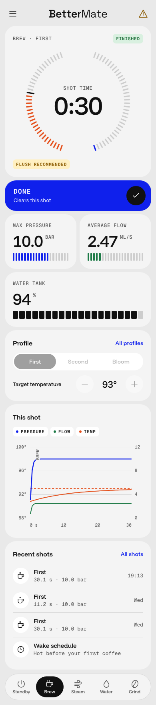 | 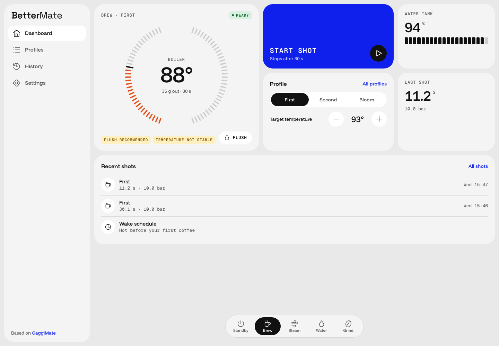 | 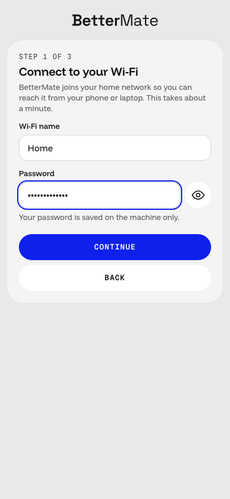 |

## Shell

- **Navigation.** From 1024 px a sidebar tile holds the wordmark, four pages (Dashboard, Profiles, History, Settings)
  and the GaggiMate credit. Below that a top bar holds the menu button, the wordmark, and a warning glyph only when a
  warning is worth a mark (none in standby, the flush reminder only in Brew, never the temperature reminder). The menu
  opens the same four pages over a scrim and closes on a choice, on Escape and on a press outside
  (`phone-navigation.png`). A detail page (the profile editor, the Analyzer, Statistics, Dashboard settings) shows Back
  in place of the menu. The Analyzer and Statistics belong to History.
- **Mode bar.** One floating bar at every window size holds Standby, Brew, Steam, Water and Grind (Grind only when a
  grinder is set up). It is state, not navigation: a press changes what the machine does and leads to the dashboard.
  The profile editor and Settings leave it out, because their own primary Button is pinned there. The collapsible
  desktop rail and the phone-landscape rail of the earlier design are gone.
- **Setup** is the whole window. The shell leaves its navigation, top bar, mode bar and skip link out on `/setup`, so
  nothing behind the page can take focus or a key press.

## Pages

- **Dashboard** (`pages/Home/`). On a phone, top to bottom: the Dial tile (eyebrow with mode and profile, one status
  Chip, the Dial, then any warning Chip and the Flush button), the ActionBanner (the next thing you can do; while a
  process runs, the ink Stop form with progress in segments), the readings two to a row, the Profile tile (favourite
  profiles as a Segmented control, a link to all profiles, the target temperature Stepper), and recent shots with the
  wake schedule as the last row. From 1200 px the same tiles sit on the twelve-column grid (`dashboard-light.png`,
  `dashboard-dark.png`); between 600 and 1199 px they keep the two-column arrangement (`tablet-dashboard.png`).
  `machineView.js` holds every word the dashboard says per machine state.
  - **Simple** shows that and nothing else: at rest the water tank and the last shot, during a shot pressure, flow,
    temperature (and weight with a scale), and the chart only for a running or finished shot (`brew-active.png`,
    `phone-finished.png`).
  - **Advanced** adds tiles and never swaps a component for a denser one: every reading with its target, the live
    chart between shots ("Last minute", on the clock, in the machine's 12 or 24 hour setting), and the curve of a
    profile that sets a pressure or a flow (`dashboard-advanced.png`).
  - **Customize** arranges the same tiles; **Dashboard settings** (`dashboard-settings.png`) is its form: the view,
    the panels and readings to show and their order, the curve height, one pinned Done.
  - Steam, Water and Grind use the same tiles (`steam-light.png`, `water-active.png`, `grind-active.png`).
- **Profiles** (`profiles.png`, `phone-profiles.png`). The title, an ink Button for New, a search input and one tile of
  rows. The profile in use has an ink icon disc and an In use Chip. A tap selects; the menu at a row's end holds edit,
  details, favourite, statistics, export, duplicate and delete (which asks once). Favourites keep their order by drag or by
  buttons; import takes JSON and TCL files.
- **Profile editor** (`profiles-first.png`, `phone-profiles-first.png`). Tiles of fields for a Standard or a Pro
  profile, the profile's curve, phases as tabs in the Pro editor, and one pinned Save. A field that the browser
  rejects says why under itself. Leaving with unsaved edits asks first.
- **Settings** (`settings.png`, `settings-machine.png`, `settings-calibration.png`, `settings-plugins.png`,
  `settings-bluetooth.png`, `settings-system.png`, `phone-settings.png`). Six tabs of tiles: a Segmented control for a
  choice of two or three, a Switch for on and off, an input (with its unit) for anything typed, a Stepper for a value
  that steps. Save is the one primary Button, pinned, with the save status above it; restart, update, export, import,
  reset and the calibration runs are secondary Buttons in their tiles.
- **Shot history** (`history.png`, `phone-history.png`). One tile per day; a row shows the profile, then duration and
  peak pressure, and opens the shot in place: chart, facts, notes and rating, export, Visualizer upload, delete (which
  asks once). The Analyzer and Statistics are links under the title.
- **Analyzer** (`analyzer.png`, `analyzer-loaded.png`, `phone-analyzer.png`). A shot and a profile slot with the
  library behind them, the shot chart with replay and export, the shot's facts, notes and rating, and the phase
  analysis table.
- **Statistics** (`statistics.png`, `statistics-built.png`, `phone-statistics.png`). A query (source, profiles, shots,
  dates, a search) and its result: summary cells, averages, trends, shot charts, profiles and phases.
- **Setup** (`setup-welcome.png`, `setup-wifi.png`, `setup-joining.png`, `setup-connected.png`). One tile per step
  with one primary Button. It opens once when the machine has no Wi-Fi name, and is reachable from Settings.

## What the dial shows

The Dial is the display's tick ring with HTML in the middle (`components/Dial.jsx`, `TickRing.jsx`): scales on the
rim, one reading in the centre. Temperature and pressure live on the dial and leave the readings in Simple, so each
fact appears once. Advanced keeps them in the readings too.

| State | Ring | Centre | Answers |
| --- | --- | --- | --- |
| Standby | Temperature, faint | Boiler temperature, next scheduled wake | Is it warm, and when does it wake? |
| Brew, heating | Temperature and pressure | Boiler temperature, "Ready in about 40 s" | How long until I can pull a shot? |
| Brew, ready | Temperature and pressure | Boiler temperature, the shot plan (`36 g out · 30 s`) | What will this shot do? |
| Pulling a shot | Temperature and pressure | Timer under the phase name, temperature, pressure | How far along, and is it on target? |
| Shot finished | Temperature and pressure | Final time, yield, ratio | How did it go? |
| Flush | Temperature and pressure | Elapsed time, pressure | Is it running? |
| Steam | One temperature ring | Boiler temperature, time to ready | Hot enough yet? |
| Water | One temperature ring | Boiler temperature, ml pumped | How hot, and how much? |
| Grind | Progress ring | Target, then progress against it | How much, and how far? |

Rules behind it, each taken from the firmware rather than assumed. These decisions stand:

- **Fixed scales and notches.** 0–160 °C and 0–16 bar with target notches, as on the display. A machine without a
  pressure sensor gets the single temperature ring, as do Steam and Water.
- **Water has no timer.** The firmware only reports elapsed time for brew and grind. It does report `wp`, which
  `Controller::activate` zeroes at the start of every process, so during Water it is the millilitres pumped since you
  pressed start. Relay-only controllers report 0, and the line stays hidden.
- **Yield.** A shot stopped by weight reports the volume it measured (`pp`); a timed shot uses the scale. The ratio
  needs a dose on the profile. The readings of a finished shot then only add what the dial does not show: max pressure
  and average flow.
- **Time to ready** is an estimate from the last 20 seconds of climb. It falls back to "9° to go" when the boiler is not
  climbing steadily, and has only been seen against the simulator's boiler model.
- **Stop by** is one setting shared by Brew and Grind in the firmware, so changing it on either changes both.
- **The mode lock.** `req:change-mode` stops the running process on the firmware, so the other modes lock while a
  process runs. Nothing locks in Steam, because leaving Steam is how steaming ends. The design's mock draws Steam
  enabled during a shot; the lock stays.
- **Reading the machine.** Slow state reaches the page a tick before telemetry. Until the first reading the dashboard
  blanks its values (`—`) instead of showing 0° as ready. A running process keeps Stop.
- **Stop clears.** The web Stop sends `deactivate` and `clear`, so Done and the finished readings appear only when a
  shot ends by itself.
- **A blank password** on the same network keeps the saved one, because Setup leaves that field out of the save.

Unchanged underneath: `services/ApiService.js`, the REST and WebSocket contract, storage keys (the theme is still
`gaggimate-daisyui-theme`), routes, lazy-loaded pages, the `gaggimate` mDNS, MQTT and HomeKit names and the upstream
credit. Legacy Coffee and Nord theme values resolve to dark and light; System follows the OS.

Decisions taken during the v2 rewrite that the user has not confirmed are listed in `docs/v2/STATUS.md`, section 3
(among them: the Dashboard's Customize view lost six options, favourites show only in a row's menu, the Analyzer's
table has four scroll buttons).

## Pictures

Every PNG here is the v2 UI in Chromium, from Vite in front of a simulator on the seeded state
(`scripts/fixtures/web-seed`: profiles First, Second and Bloom, two synthetic shots), taken on 2026-11-14 after the
integration pass. Desktop is 1440 px wide, the tablet 900 px, the phone 390 px; a page longer than the window is
shown whole. They do not come from the embedded production bundle: that build follows the integration pass.

| Desktop light | Desktop dark |
| --- | --- |
|  | 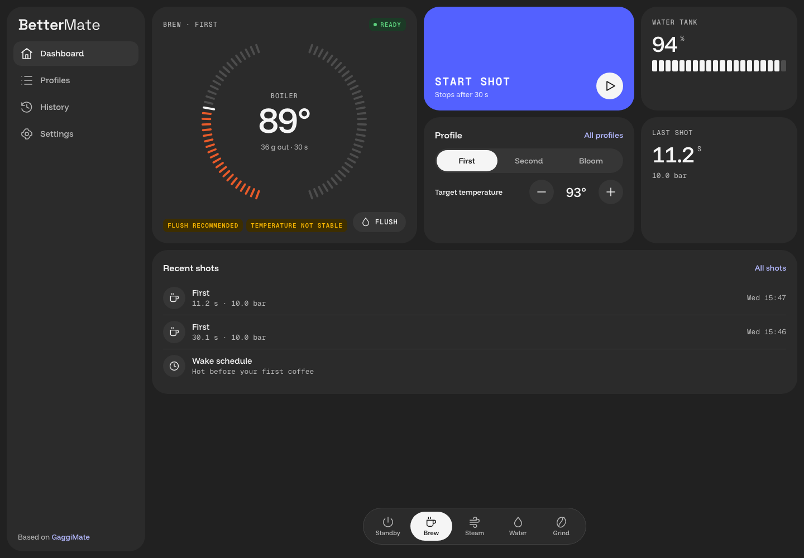 |
| 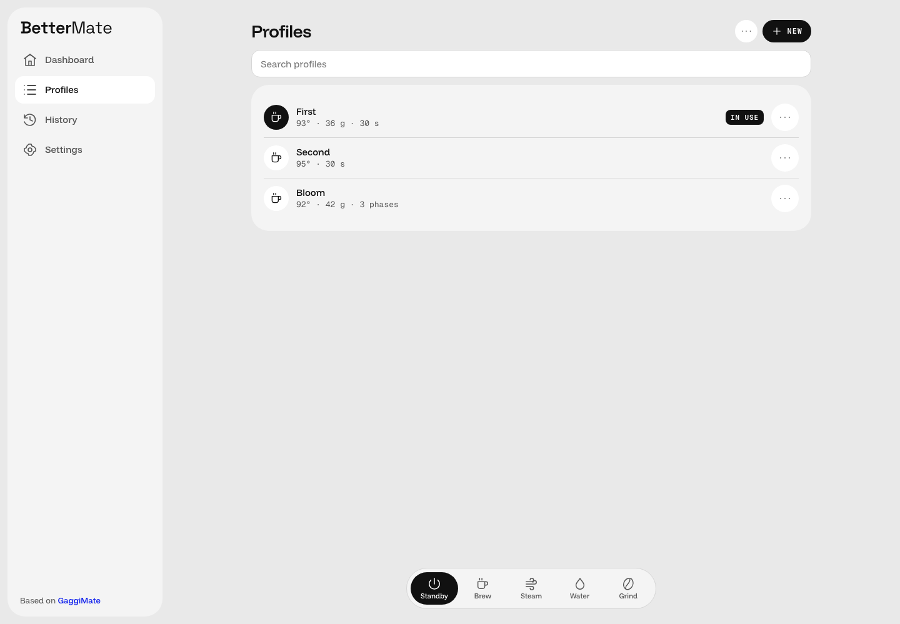 |  |
| 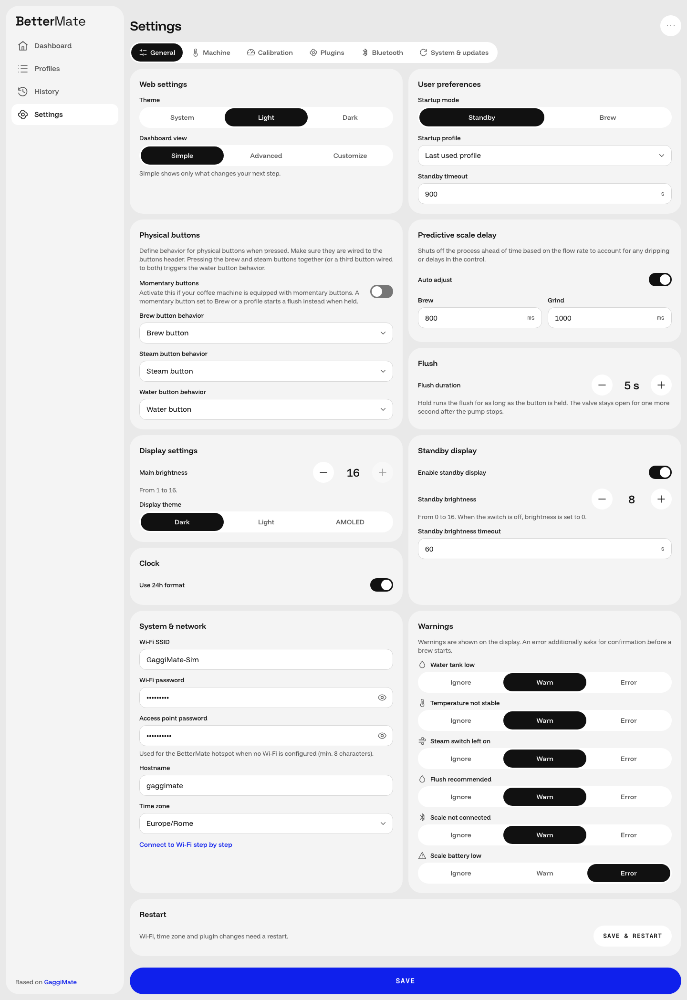 | 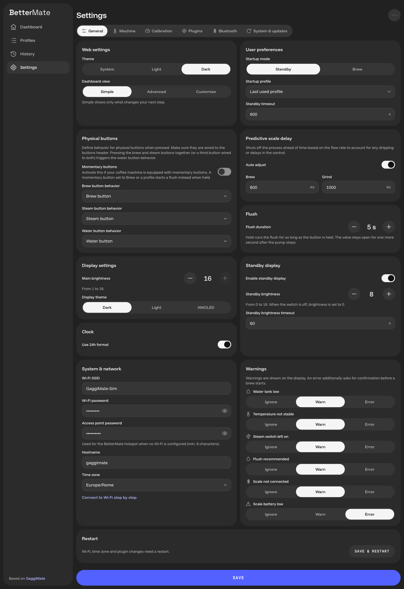 |
| 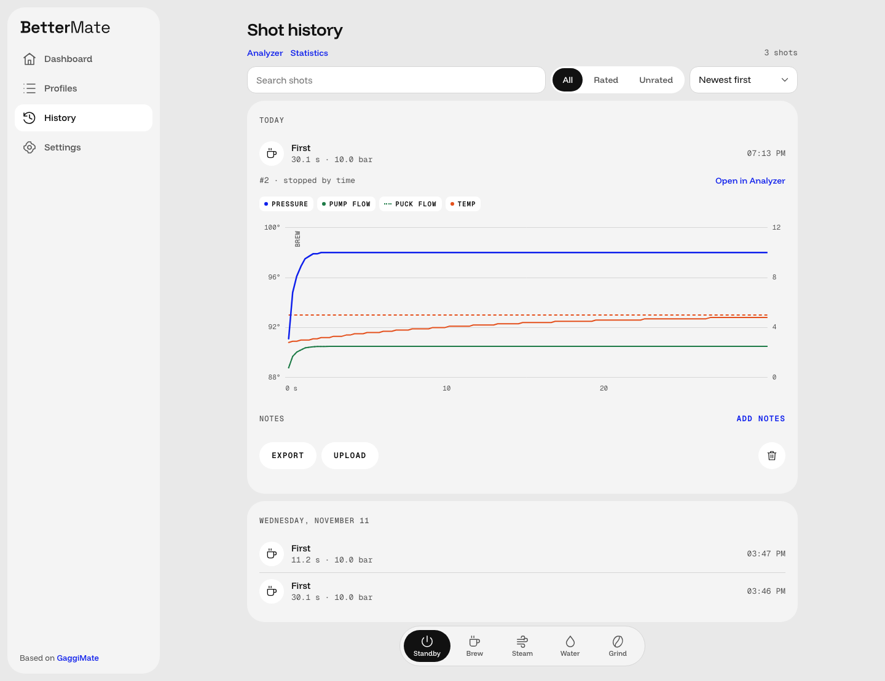 | 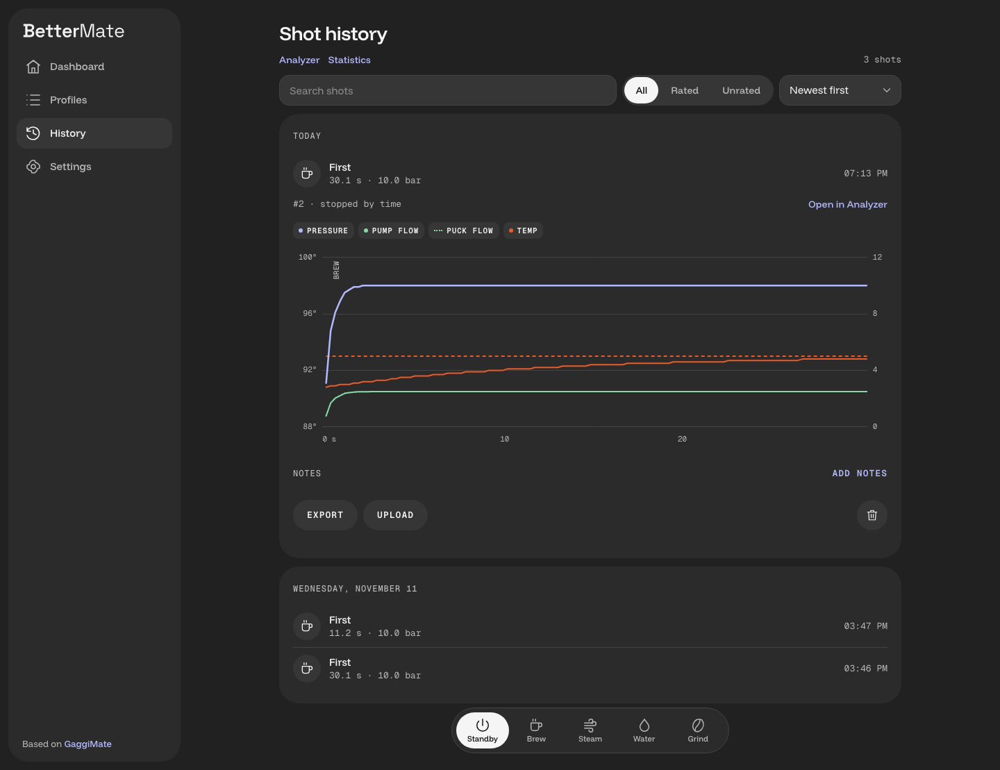 |
| 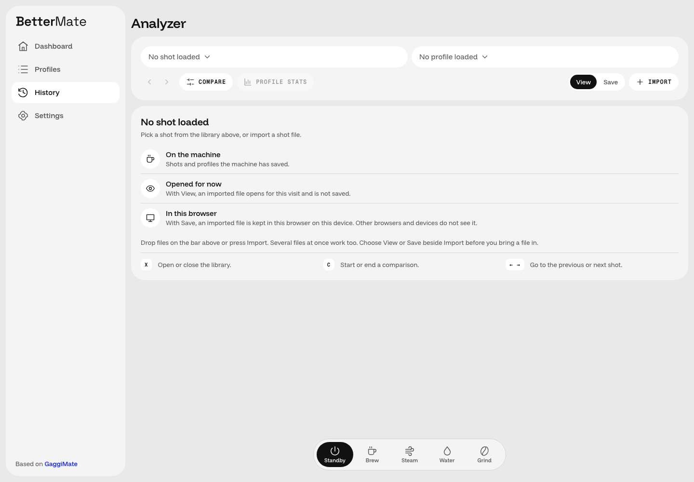 | 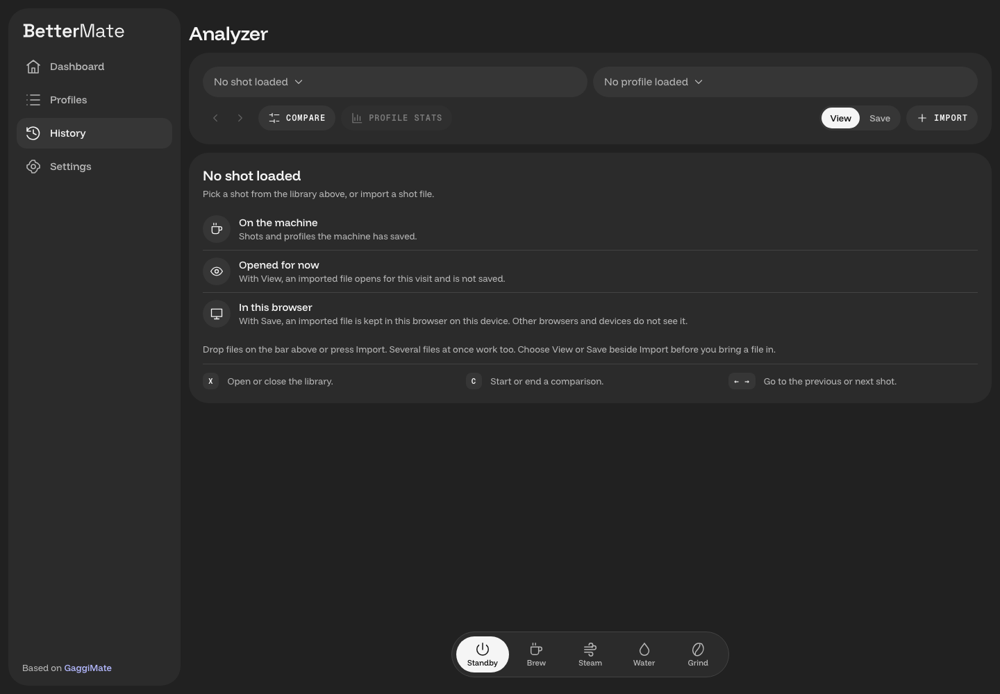 |
| 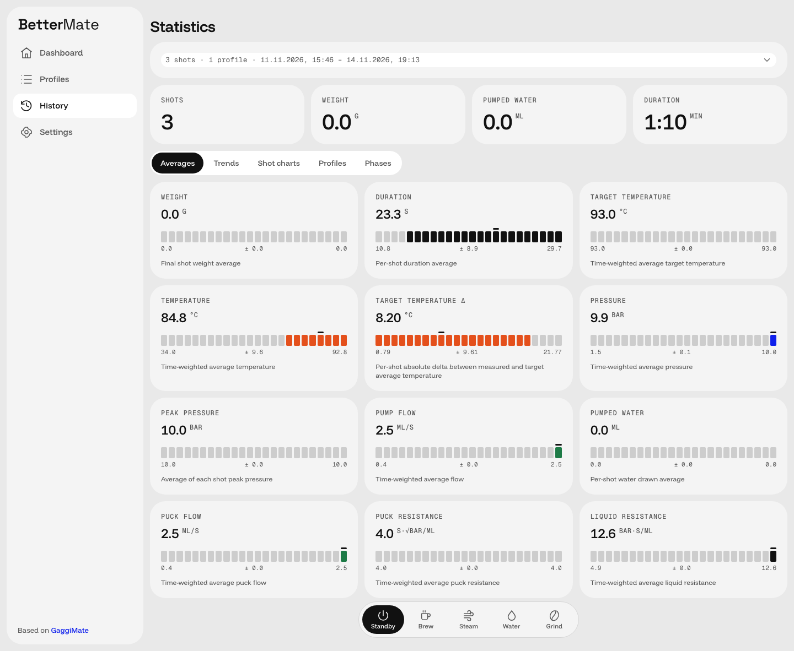 | 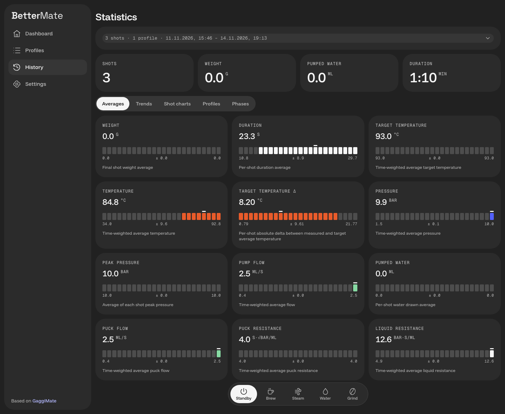 |

`phone-landscape.png` is gone with the landscape mode rail it showed.

## Verification

`scripts/verify_web_ui.mjs` is the committed check of the web UI. It was rewritten for v2 on 2026-11-14 and passed
**624 assertions, none failed**, against Vite in front of a simulator (`results.json`):

- **Shell** (31 assertions): the sidebar's four pages and which one is current, the top bar and its menu on a phone
  (open, focus, Escape, a choice), Back on detail pages, the mode bar's modes and where it is left out, the skip link,
  and that `/setup` has no shell and Tab only visits the step's own controls.
- **Pages** (576 assertions): sixteen routes (the dashboard, Dashboard settings, Profiles, the editor of a profile and
  of a new one, the six Settings tabs, Shot history, the Analyzer, Statistics, Setup, an unknown address) at 390 and
  1440 px in light and dark. Each loads with its title and without an error in the console, has one page title, does
  not scroll sideways, wears the theme and the two bundled faces, has no shadow, blur, filter or gradient and no
  reading that says NaN, and has the shell around it (or not, on Setup).
- **Flows** (17 assertions) on the desktop, each read back from the machine over its WebSocket or REST as well as
  from the page: every mode of the bar, the target temperature up and down, a shot started and stopped (the Stop
  banner with its progress, the other modes locked, the live chart), a profile selected on the Profiles page and
  again from the dashboard, a setting saved, read back through `GET /api/settings` and after a reload, and restored,
  a shot opened in Shot history, a shot loaded in the Analyzer from the library, a Statistics query run.

The page lanes' own checks (several thousand assertions on single pages, kept outside the repository) were rerun after
the integration pass; `docs/v2/STATUS.md` records the result.

`npm run lint:check` has no errors and six known hook warnings in Statistics (`lint.log`).

Not covered: Chromium only, with phone emulation, so iOS Safari safe areas and address-bar behaviour are unchecked
(the Dashboard's `reading.css` uses a container query). The check has not run against the embedded production bundle
yet. A scale, Bluetooth, OTA and a real restart are not on the simulator. Nothing was flashed.

## Reproduce

Run the check only against a disposable simulator: it changes the mode, the target temperature, the selected profile
and one setting, pulls a short shot, and puts all but the shot back. From the repository root:

```sh
# A seeded simulator in a scratch directory (it keeps its state in ./sim_data). Port 8080 is Docker's on this Mac.
mkdir -p /tmp/bettermate-web/sim_data && cp -R scripts/fixtures/web-seed/. /tmp/bettermate-web/sim_data/
cp .pio/build/display-sim/program /tmp/bettermate-web/        # pio run -e display-sim builds it
(cd /tmp/bettermate-web && SIM_HTTP_PORT=8090 SDL_VIDEODRIVER=dummy ./program) &

# Vite in front of it
(cd web && SIM_HTTP_PORT=8090 npx vite --port 5173 --strictPort --host 127.0.0.1) &

node scripts/verify_web_ui.mjs http://127.0.0.1:5173/ \
  --playwright-module /absolute/path/to/playwright/index.mjs --output /tmp/bettermate-web/results
```

The first argument is the base URL. Against the embedded bundle, pass the simulator's own address
(`http://127.0.0.1:8090/`) once `scripts/build_webui.sh` and `pio run -e display-sim` have embedded the v2 build.
`--only shell,pages,flows` runs some of the parts; `--output` writes `results.json` and a picture of every page and
state visited. It prints one line per failure and a tally per part, and exits 1 if anything failed.
